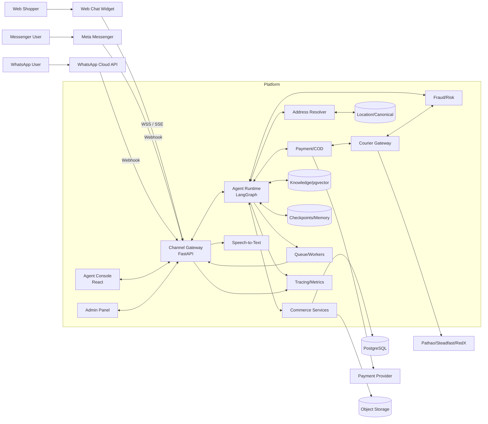
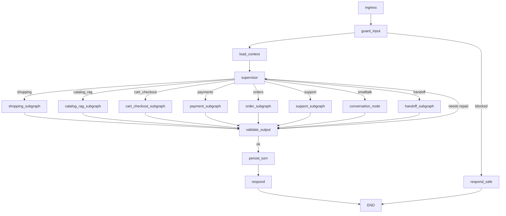
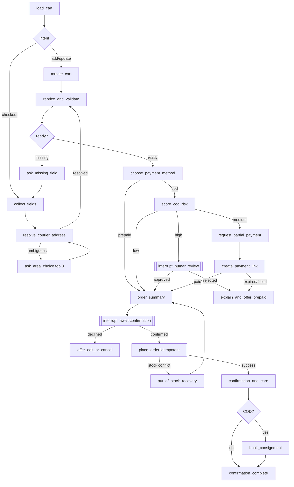
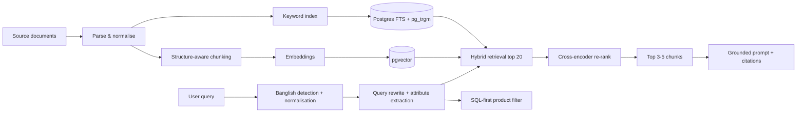
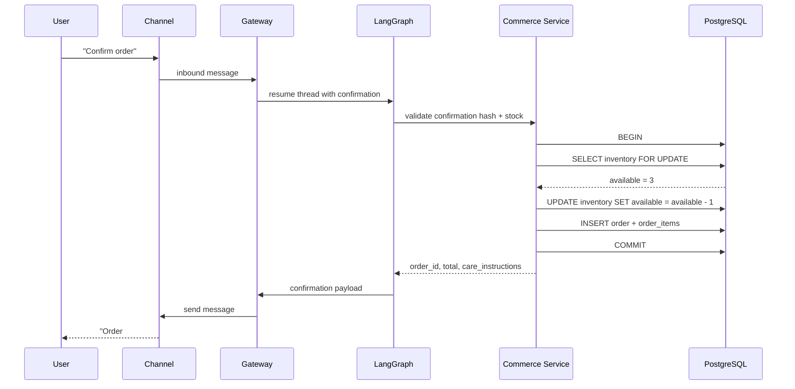
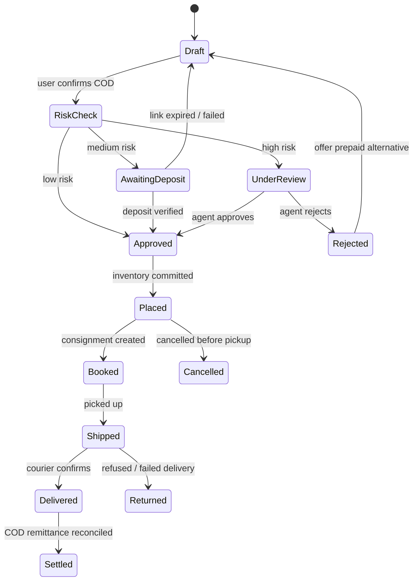
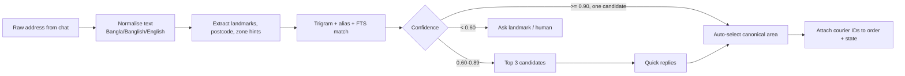
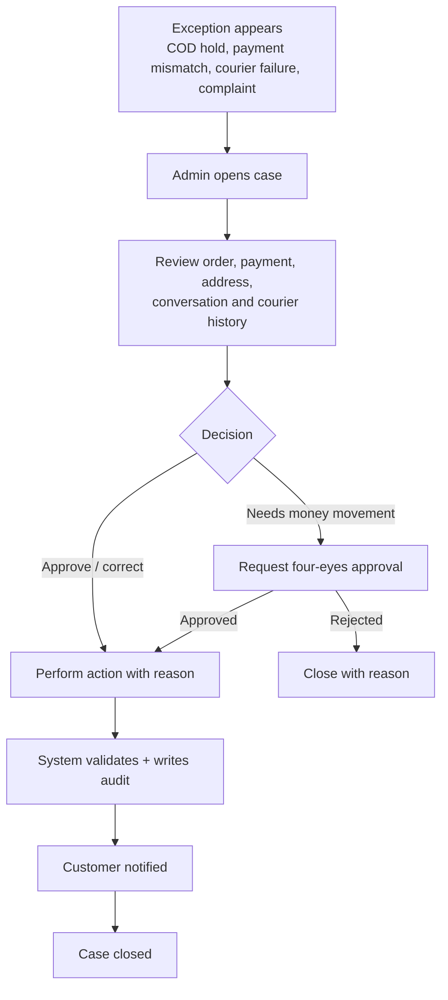
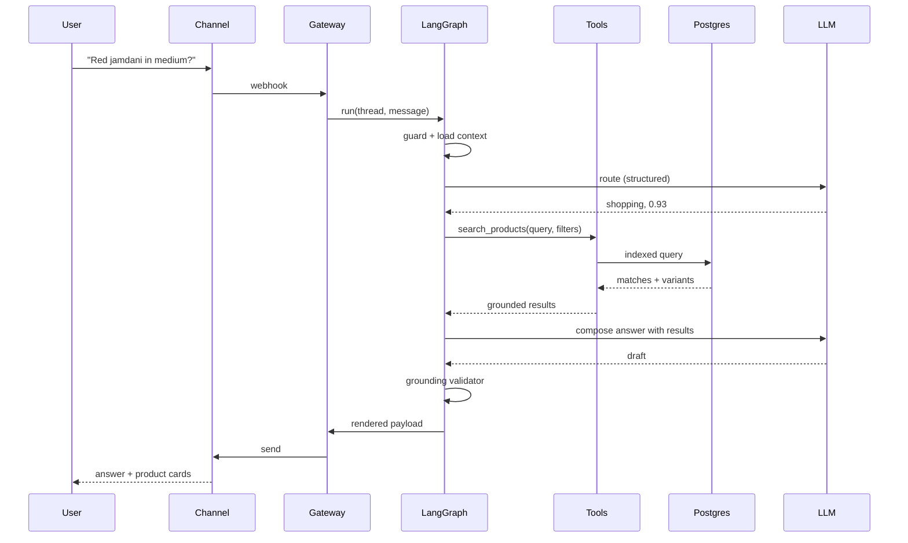
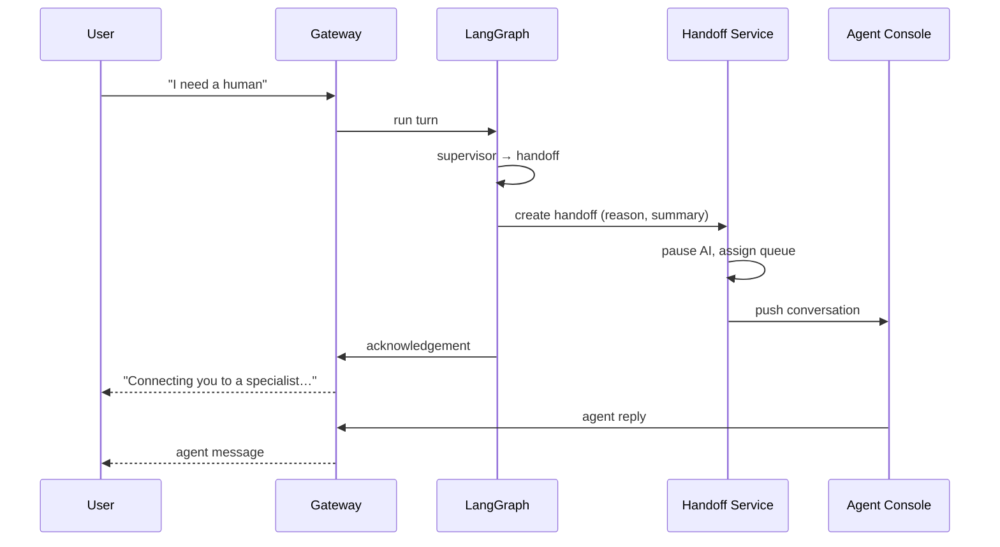

# Product Requirements Document (PRD)

## OmniCart — Agentic AI Commerce Assistant

**A LangChain + LangGraph based conversational commerce platform for Web, Facebook Messenger and WhatsApp**

| Field | Value |
|---|---|
| Document version | 2.3 |
| Status | Approved for build |
| Revision focus | COD and partial payments, courier booking and COD fraud screening, **dedicated admin panel with full manual back-office control**, structured Bangladesh city/zone/area resolution and canonical courier mapping, inbound voice-note transcription, Banglish search, API cost optimization, web-first channel rollout |
| Product owner | Head of Digital Commerce |
| Technical owner | AI Platform / Backend Engineering |
| Document date | 21 November 2026 |
| Supersedes | "AI Commerce Assistant Architecture Documentation" v1.0 (ManyChat + n8n stack) |
| Audience | Product, Engineering, QA, DevOps, Security, Customer Support Operations |

---

## Table of Contents

1. [Executive Summary](#1-executive-summary)
2. [Problem Statement and Opportunity](#2-problem-statement-and-opportunity)
3. [Goals, Non-Goals and Success Metrics](#3-goals-non-goals-and-success-metrics)
4. [Users, Personas and Journeys](#4-users-personas-and-journeys)
5. [Scope](#5-scope)
6. [Functional Requirements](#6-functional-requirements)
7. [Non-Functional Requirements](#7-non-functional-requirements)
8. [Solution Architecture](#8-solution-architecture)
9. [Agentic Framework Design (LangGraph)](#9-agentic-framework-design-langgraph)
10. [LangChain Component Design](#10-langchain-component-design)
11. [Channel Integration](#11-channel-integration)
12. [Retrieval-Augmented Generation (RAG)](#12-retrieval-augmented-generation-rag)
13. [Memory and Personalization](#13-memory-and-personalization)
14. [Commerce Domain and Transaction Integrity](#14-commerce-domain-and-transaction-integrity)
15. [Data Model](#15-data-model)
16. [API Specification](#16-api-specification)
17. [Human-in-the-Loop, Agent Console and Admin Panel](#17-human-in-the-loop-agent-console-and-admin-panel)
18. [Security, Privacy and Compliance](#18-security-privacy-and-compliance)
19. [Observability, Evaluation and Quality](#19-observability-evaluation-and-quality)
20. [Resilience and Fallback](#20-resilience-and-fallback)
21. [Performance and Scaling](#21-performance-and-scaling)
22. [Deployment and DevOps](#22-deployment-and-devops)
23. [Testing and Acceptance Criteria](#23-testing-and-acceptance-criteria)
24. [API Cost Optimization](#24-api-cost-optimization)
25. [Roadmap and Milestones](#25-roadmap-and-milestones)
26. [Risks and Mitigations](#26-risks-and-mitigations)
27. [Open Decisions](#27-open-decisions)
28. [Appendices](#28-appendices)

---

## 1. Executive Summary

OmniCart is an AI-powered commerce assistant that holds natural conversations with shoppers and buyers across three channels — a website chat widget, Facebook Messenger and WhatsApp — and completes real commerce work: product discovery, comparison, stock checks, cart building, checkout, order tracking, cancellations, returns, complaints, policy answers and human escalation.

Version 1.0 of this system depended on ManyChat for the customer interface and n8n for orchestration. That design had four structural limits: business logic lived in a visual workflow tool that is hard to version, test and review; conversation state was split between ManyChat and the application; every new channel required rebuilding flows; and the reasoning layer was a fixed router rather than an agent capable of multi-step tool use.

**This PRD replaces that stack entirely.** Both ManyChat and n8n are removed. In their place:

- **LangGraph** becomes the single orchestration runtime. The conversation is an explicit, versioned state machine (`StateGraph`) with a supervisor agent, domain sub-agents, deterministic tool nodes, durable checkpointing, interrupts for human approval, and full replayability.
- **LangChain** supplies the model abstraction, tool calling, structured output, retrievers, embeddings, memory stores and callback/tracing integrations.
- **A channel gateway built in FastAPI** owns all channel integrations (WebSocket/SSE for web, Meta Graph API for Messenger, WhatsApp Cloud API), so the agent is channel-agnostic and one graph serves all three surfaces.
- **PostgreSQL + pgvector** replaces the separate vector database for retrieval and long-term semantic memory, while **Redis** handles caching, rate limiting and idempotency.
- **A first-party agent console** replaces ManyChat's inbox for human handoff.

The result is a production-grade, testable, observable agentic platform that a commerce team can operate and an engineering team can extend without touching a visual workflow builder.

**Revisions 2.1–2.3 add the capabilities required to run real South Asian e-commerce operations:**

- **Cash on Delivery and partial payment** as first-class checkout methods, with a COD-specific confirmation, address-quality and risk-approval flow.
- **Courier integration and COD fraud screening** through Pathao, Steadfast and RedX: parcel booking, consignment and tracking IDs, live delivery events, and a fraud score built from the customer's past delivery, return and cancellation history before a COD order is accepted.
- **Structured Bangladesh address resolution:** free-text addresses are resolved into canonical city → zone → area records, mapped to Pathao, RedX and Steadfast IDs, cached locally, and reused across courier failover — so changing courier never means re-asking the customer for an address.
- **A dedicated Admin Panel (v2.3):** a separate back-office application where a Super Admin can manually handle every business object and exception end to end — orders, payments, COD approvals, refunds, stock, prices, couriers, conversations, knowledge, AI settings and users — without touching the database or asking engineering.
- **Inbound voice notes** on every channel, transcribed to text before the agent runs, so shoppers can speak instead of type. Outbound voice and telephony remain out of scope.
- **Banglish and phonetic Bangla search**, so queries typed in Latin script ("lal jamdani ta hobe?", "dam koto?") retrieve the right products instead of missing on exact column matches.
- **Cost engineering as a product requirement**: tiered model routing, provider prompt caching, aggressive context trimming, semantic caching, SQL-first product search, message debouncing and disciplined use of the WhatsApp 24-hour service window, with a target of 40–60% lower recurring API cost.
- **A web-first channel rollout.** The web widget ships first and proves the agent, commerce and payment loops end to end; Messenger and WhatsApp are enabled only after explicit channel-readiness gates pass, because Meta app review, template approval and messaging-window compliance add delivery risk.

### 1.1 What changes versus v1.0

| v1.0 component | v2.3 replacement | Reason |
|---|---|---|
| ManyChat (UI, session state, flow trees) | React web chat widget + Meta channel adapters + LangGraph checkpointer | Removes vendor lock-in and per-contact cost; one conversation model for all channels |
| n8n (orchestration, routing, retries) | LangGraph `StateGraph` + FastAPI runtime + task queue | Version-controlled, unit-testable orchestration; deterministic routing; durable execution |
| ManyChat inbox for human takeover | Agent Console with conversation queue, assignment, AI pause/resume | Native HITL with full context, SLAs and audit trail |
| ManyChat broadcast | Channel-aware campaign service (template messages + opt-in registry) | Compliance with Meta messaging windows and opt-in rules |
| ChromaDB | PostgreSQL + pgvector (or managed pgvector) | One transactional datastore; simpler backups and access control |
| Telegram-only admin panel | Agent Console + optional Slack/Telegram alerting | Operational depth; alerting stays optional |

---

## 2. Problem Statement and Opportunity

### 2.1 Current problems

1. **Conversations are fragmented.** Shoppers ask on the website, continue on Messenger, and check delivery on WhatsApp. The old stack treated each as a separate flow with separate state.
2. **Routine work consumes human time.** Order status, delivery charges, return policy, size availability and stock checks account for the majority of support contacts.
3. **Flow-based bots break on variation.** A button tree cannot handle "the red one I saw last week, is it available in medium?" without a human.
4. **Orchestration is opaque.** Visual workflows are difficult to code-review, test in CI, diff across environments, or roll back safely.
5. **Conversion leaks.** Shoppers abandon when answers are slow, when a product is out of stock and no alternative is offered, or when checkout requires leaving the chat.
6. **Channel expansion is expensive.** Each new channel previously meant a new ManyChat/n8n flow set.
7. **Cash on Delivery is operationally risky.** A large share of local orders are COD, yet without delivery-history checks and courier confirmation, the business absorbs refused parcels, fake orders and return shipping costs.
8. **Courier data is disconnected.** Staff book parcels manually and copy tracking IDs between systems, so customers asking "where is my parcel?" get slow, inconsistent answers.
9. **Voice notes are ignored.** Shoppers on WhatsApp and Messenger often send audio instead of typing; a text-only assistant appears broken to them.
10. **Banglish queries miss.** Customers type Bangla in Latin script, and exact matching on English/Bangla columns silently fails, losing ready-to-buy demand.
11. **Costs grow faster than revenue.** Every greeting and repeated FAQ can trigger a full LLM run and a paid message if the system is not deliberately engineered for cost.

### 2.2 Opportunity

- 24/7 instant answers with sub-3-second response targets.
- Higher conversion through in-chat discovery, comparison, offers, cart recovery and checkout.
- Lower cost per contact through automation containment, while preserving a fast path to a human.
- A single agent brain that scales to new channels (Instagram DM, Telegram, mobile app) by adding an adapter, not a new bot.
- COD conversion without COD losses: fraud scoring and courier integration turn a high-risk payment method into a controlled one.
- Cost leadership: a deliberately tiered, cached and debounced architecture keeps unit economics viable as volume grows.

---

## 3. Goals, Non-Goals and Success Metrics

### 3.1 Product goals

| ID | Goal |
|---|---|
| G1 | Resolve routine commerce and support requests end-to-end in chat without human involvement. |
| G2 | Offer one consistent, personalized assistant across Web, Messenger and WhatsApp. |
| G3 | Complete orders safely with deterministic tools, stock locking and idempotency. |
| G4 | Never fabricate price, stock, order status or policy; ground every factual claim in tool or retrieval output. |
| G5 | Hand off to a human seamlessly, with full context, when confidence is low, the user asks, or the task exceeds agent authority. |
| G6 | Make the agent observable, evaluable and safe to change through versioned prompts, graph versions and automated evals. |
| G7 | Keep integration effort low: adding a channel requires only an adapter and a renderer. |
| G8 | Accept Cash on Delivery and partial payment safely, with fraud screening, courier booking and a clear approval path. |
| G9 | Understand inbound voice notes and Banglish queries without forcing customers to change how they write or speak. |
| G10 | Operate within explicit cost budgets through routing, caching, debouncing and channel-window discipline. |
| G11 | Resolve Bangladeshi addresses into courier-valid city/zone/area IDs reliably, and keep one canonical mapping so courier failover never forces the customer to repeat their address. |
| G12 | Give the business a dedicated Admin Panel where a Super Admin can manually operate, correct and override every entity and workflow — with RBAC, reason codes and a complete audit trail. |

### 3.2 Non-goals (v2.3)

- Outbound voice and telephony agents (IVR, automated calls). **Inbound voice notes are in scope** and are transcribed to text.
- Native mobile SDKs.
- Marketplace multi-vendor settlement and payouts.
- Fully autonomous refunds above a configurable value threshold (human approval required).
- Replacing the existing e-commerce backend/PIM/ERP; the assistant integrates with them.
- Building a general-purpose chatbot unrelated to commerce.
- Acting as the merchant of record for COD reconciliation; the platform books parcels and tracks status but financial settlement stays in the ERP.

### 3.3 Success metrics

| Metric | Definition | Target (90 days post-launch) |
|---|---|---|
| Automation containment | % of conversations resolved without human handoff | ≥ 60% |
| Resolution rate | % of conversations where user confirms the issue is solved | ≥ 75% |
| First response latency | p95 time from inbound message to first token/ack | ≤ 2.5 s |
| End-to-end latency | p95 for non-transactional replies | ≤ 6 s |
| Checkout conversion | Chat-initiated checkout completion | ≥ 35% |
| Cart recovery | Recovered carts from proactive nudges | ≥ 12% |
| CSAT | Post-conversation rating | ≥ 4.3 / 5 |
| Hallucination rate | Responses contradicting tool/RAG data (sampled + automated) | < 0.5% |
| Handoff time | Time from escalation intent to human assignment | ≤ 60 s (business hours) |
| Cost per conversation | Model + infrastructure cost | ↓ 40–60% vs untuned baseline |
| Tool error rate | Failed tool executions / total | < 1% |
| COD confirmation rate | COD orders successfully delivered / COD orders confirmed | ≥ 85% |
| COD refusal rate | Refused-on-delivery parcels / COD parcels shipped | ≤ 10% |
| Fraud precision | High-risk COD orders correctly blocked or held | ≥ 90% precision, < 3% false positives |
| Courier booking success | Parcels booked on first attempt | ≥ 99% |
| Voice-note success | Voice notes transcribed and answered without asking the user to retype | ≥ 95% |
| Banglish retrieval hit | Banglish queries returning the intended product in top 3 | ≥ 90% |
| LLM avoidance rate | Turns answered by rules/cache without an LLM call | ≥ 35% |
| Prompt cache hit rate | Input tokens served from provider prompt cache | ≥ 60% |
| Messaging cost per order | WhatsApp/Messenger spend divided by orders | ↓ 50% vs untuned baseline |
| Address auto-resolution | Addresses resolved to city/zone/area without human or repeated questions | ≥ 95% |
| Address resolution latency | p95 `resolve_courier_address` call | ≤ 300 ms (local index) |
| Courier failover without re-ask | Failovers completed using the canonical address | 100% |
| Address-caused delivery failure | Failed deliveries attributable to wrong zone/area | ≤ 2% |
| Manual resolution time | Median time for an admin to resolve an escalated order/payment exception | ≤ 5 minutes |
| Admin audit coverage | Sensitive admin actions with actor, reason and before/after values | 100% |
| Manual operation success | Admin-initiated actions completing without a second correction | ≥ 98% |
| Admin availability | Admin panel monthly uptime | ≥ 99.9% |

---

## 4. Users, Personas and Journeys

### 4.1 Personas

| Persona | Needs | Primary channel |
|---|---|---|
| **Browsing Shopper** (pre-purchase) | Inspiration, size/color availability, price, offers, comparison | Web widget, Messenger |
| **Decisive Buyer** | Fast checkout, delivery estimate, payment options, confidence | Web, WhatsApp |
| **Existing Customer** | Order status, modification, cancellation, invoice | WhatsApp, Messenger |
| **After-Sales Customer** | Return, exchange, refund, defect report, complaint | WhatsApp, Web |
| **Support Agent** | Full conversation context, AI summary, suggested replies, pause AI, resolve | Agent Console |
| **Store Operator / Admin** | Full manual control of catalogue, orders, payments, couriers, content, users and analytics | **Dedicated Admin Panel**, optional Slack/Telegram alerts |
| **Developer / AI Engineer** | Versioned prompts, graph changes, evals, traces, replay | LangSmith, CI, Admin API |

### 4.2 Key journeys

**J1 — Discover and buy (Web).** User opens widget → "show me cotton sarees under 3000" → assistant calls `search_products` → returns a carousel → user selects a variant → adds to cart → provides name, phone, address → confirmation summary → explicit confirmation → `place_order` → order ID + care instructions.

**J2 — Check an order (WhatsApp).** "Where is my order?" → identity resolved by channel identity → assistant lists recent orders → user taps one → `track_order` → status, carrier, ETA → offer notification opt-in.

**J3 — Out-of-stock save (Messenger).** "Do you have the red jamdani in M?" → stock says 0 → assistant offers 3 similar in-stock alternatives within budget → user selects → checkout continues. No dead end.

**J4 — Policy question with low retrieval confidence.** Return policy question → RAG retrieves nothing above threshold → assistant does not guess → offers human handoff and creates a ticket with the question attached.

**J5 — Human handoff.** "I want to talk to a person" → graph raises `interrupt` → conversation enters agent queue → AI is paused → agent sees transcript, customer summary, order context → agent replies → user continues; AI resumes or closes on resolution.

**J6 — Refund request.** User uploads a defect photo → vision extracts attributes → return flow validates policy window and order → creates return request → human approves above threshold → user receives instructions and label link.

**J7 — COD order with fraud screening.** Buyer chooses Cash on Delivery → assistant validates address quality and phone reachability → `score_cod_risk` checks past delivery, return and cancellation history → low risk: order confirmed and parcel booked with the preferred courier → medium risk: partial prepayment (delivery charge or 20%) requested to secure the order → high risk: order held for human review, with a polite explanation. Only after approval is a consignment created and a tracking ID stored.

**J8 — Voice note on WhatsApp.** User sends a 14-second audio note: "ei lal saree ta dam koto, medium size ache?" → gateway downloads media → `transcribe_audio` produces a transcript with language tag → the normal agent turn runs on the transcript → assistant replies in text with price, size availability and product cards. The user is never asked to retype.

**J9 — Banglish search.** User types "lal jamdani ta hobe? dam koto?" → query normaliser detects Latin-script Bangla, transliterates and expands synonyms → SQL full-text plus phonetic trigram search runs alongside vector search → the intended red jamdani appears in the top three results; the assistant answers in Bangla or English based on the user's style.

**J10 — Partial payment.** Buyer cannot pay the full amount on COD → assistant offers a partial prepayment option (delivery fee or configured percentage) → creates a payment intent and hosted link → webhook confirms payment → the remaining balance is collected on delivery and the order is released for courier booking.

**J11 — Ambiguous Dhaka address.** Buyer types "Mirpur, Dhaka" → `resolve_courier_address` detects multiple zone matches (Mirpur 1, Mirpur 10, Mirpur 11, Mirpur DOHS) → assistant shows the top three as quick replies → buyer taps "Mirpur 10" → the canonical area is stored with Pathao/RedX/Steadfast mappings → successful quote and booking, with no free-text address guessing.

**J12 — Courier failover without re-asking.** Pathao is unavailable at booking time for a Mirpur 10 address → the courier gateway reads the canonical area already resolved during checkout → switches to RedX using its own area ID → the parcel is booked and the customer sees only a normal confirmation, never an address question.

**J13 — Admin resolves a stuck order manually.** A COD order is held, the payment webhook is missing and the courier booking failed → the admin opens the order in the Admin Panel, reviews the risk signals and provider events, records the payment, approves the COD override, re-resolves the address, books the backup courier, updates the tracking ID, notifies the customer and closes the case — with a reason code and full audit for every step.

---

## 5. Scope

### 5.1 In scope

| Area | Included |
|---|---|
| Channels | **Web widget first**, then Facebook Messenger and WhatsApp Business (Cloud API) after channel-readiness gates |
| Conversation | Text, **inbound voice notes (transcribed)**, images, quick replies, buttons, carousels, product cards, order cards, typing indicators, read receipts |
| Shopping | Search, filters, similarity search, comparison, offers, stock, variants, recommendations, **Banglish/phonetic query normalisation** |
| Transaction | Cart, coupon, delivery quote, checkout, order placement, order tracking, cancellation, **COD, partial prepayment, online payment** |
| Fulfilment | **Courier booking (Pathao, Steadfast, RedX), consignment/tracking IDs, live delivery events, COD remittance status, structured city/zone/area resolution and canonical courier mapping** |
| Risk | **COD fraud scoring from delivery, return and cancellation history; manual review queue** |
| After-sales | Returns, exchanges, complaints, tickets, policy Q&A |
| Intelligence | Intent classification, supervisor routing, tool calling, RAG, hybrid memory, multimodal image search, **speech-to-text** |
| Cost controls | **Tiered model routing, prompt caching, context trimming, semantic cache, SQL-first search, message debouncing, messaging-window discipline** |
| Operations | HITL console, AI pause/resume, canned replies, assignment, SLA timers, admin configuration, **COD review queue** |
| **Back office** | **Dedicated Admin Panel with full manual control: orders, payments, COD/refunds, inventory, prices, offers, couriers, address mappings, conversations, knowledge, prompts/models, users, roles, settings, imports/exports, audit** |
| Platform | Multi-tenant-ready design, observability, evaluation suite, CI/CD, backup/DR |

### 5.2 Out of scope for v2.3

Outbound voice and telephony, native mobile apps, marketplace settlement, autonomous high-value refunds, loyalty points engine, warehouse/ERP replacement, ad campaign management, and non-English UI beyond English and Bangla conversational support (Bangla remains supported in content and replies, including Banglish input).

### 5.3 Assumptions and dependencies

- An existing commerce backend (catalogue, pricing, inventory, orders) is available through internal APIs or a database the assistant can access through the service layer.
- Meta Business account, Facebook Page, WhatsApp Business Account and approved phone number are available **before the Messenger/WhatsApp phases, not before web launch**.
- Courier merchant accounts and API credentials for Pathao, Steadfast and RedX are available, with at least one primary and one backup courier per delivery zone.
- Courier location APIs (Pathao city/zone/area, RedX city/zone/area, Steadfast district list) are reachable for scheduled synchronisation, and the business accepts a weekly refresh cadence with manual on-demand refresh.
- A payment provider supporting hosted payment links, partial payments and signed webhooks is available; the assistant never handles card data.
- A speech-to-text provider (e.g., Whisper API) is available, with a self-hosted fallback option for cost control.
- Product content, policies and FAQs are available as source documents for ingestion.
- Historical order, delivery, return and cancellation data exists in a form that can seed the fraud-scoring features.

---

## 6. Functional Requirements

Priorities: **M** = Must have (launch blocker), **S** = Should have, **C** = Could have.

### 6.1 Channel and conversation

| ID | Priority | Requirement |
|---|---|---|
| FR-CH-01 | M | The system shall expose a website chat widget embeddable with a single script tag and configurable theme, position, greeting and locale. |
| FR-CH-02 | M | The system shall receive and reply on Facebook Messenger through the Meta Graph API with webhook signature verification. |
| FR-CH-03 | M | The system shall receive and reply on WhatsApp through the WhatsApp Cloud API, supporting text, media, quick replies and template messages. |
| FR-CH-04 | M | All channels shall map to one internal message envelope so that one agent graph serves every channel. |
| FR-CH-05 | M | The system shall show typing indicators and delivery/read status where the channel supports them. |
| FR-CH-06 | M | The system shall render channel-appropriate rich responses (carousel on web/Messenger, list/button messages on WhatsApp) with automatic downgrade to text when unsupported. |
| FR-CH-07 | M | The system shall de-duplicate webhook retries by channel message ID and guarantee at-most-once processing of side effects. |
| FR-CH-08 | S | The web widget shall stream responses token-by-token over SSE. |
| FR-CH-09 | S | The system shall support image upload from all three channels for visual product search and defect evidence. |
| FR-CH-10 | M | The assistant shall answer in the language the user writes in (English and Bangla at launch). |
| FR-CH-11 | M | The system shall accept inbound voice notes on web, Messenger and WhatsApp, transcribe them before agent processing, and reply in text. |
| FR-CH-12 | M | The system shall confirm transcription success silently (or with a brief note when confidence is low) and never require the user to retype a clear voice note. |
| FR-CH-13 | S | The system shall support voice notes up to 2 minutes and 16 MB, rejecting longer media with a helpful message. |

### 6.2 Shopping and product discovery

| ID | Priority | Requirement |
|---|---|---|
| FR-SH-01 | M | Search products by free-text query, category, price range, color, size, fabric, availability and offers. |
| FR-SH-02 | M | Return structured product cards with image, name, price, currency, variant summary, availability and a deep link. |
| FR-SH-03 | M | Compare two to four products on price, attributes, availability and care instructions. |
| FR-SH-04 | M | Show active offers and coupons with validity and eligibility rules. |
| FR-SH-05 | M | When an item is unavailable or outside budget, proactively offer up to three in-stock alternatives (retention rule). |
| FR-SH-06 | S | Support visual search: user uploads an image, vision model extracts attributes, system performs exact SQL filtering plus semantic retrieval. |
| FR-SH-07 | S | Personalize ranking using stored preferences and browsing signals. |
| FR-SH-08 | M | Never state price or stock except as returned by a tool call in the current turn. |
| FR-SH-09 | M | Detect Banglish (Bangla typed in Latin script) and normalise it for search, including transliteration, spelling variants and common abbreviations. |
| FR-SH-10 | S | Use exact PostgreSQL filtering when the query carries explicit attributes, and reserve embeddings for fuzzy or descriptive queries. |

### 6.3 Cart and checkout

| ID | Priority | Requirement |
|---|---|---|
| FR-CO-01 | M | Create, read, update and clear a cart bound to the resolved user and channel conversation. |
| FR-CO-02 | M | Validate variant availability and quantity before adding to cart; return a clear reason on failure. |
| FR-CO-03 | M | Apply, validate and remove coupons; recompute totals server-side. |
| FR-CO-04 | M | Provide delivery charge and ETA based on destination and cart contents. |
| FR-CO-05 | M | Collect checkout fields (name, phone, address, optional email) with per-field validation and correction. |
| FR-CO-06 | M | Present a final order summary and require explicit user confirmation before placing an order. |
| FR-CO-07 | M | Place orders transactionally with inventory row locking and idempotency keys; return order ID, total and care instructions. |
| FR-CO-08 | M | Never accept or store card data; issue a hosted payment link when prepayment is required. |
| FR-CO-09 | S | Recover abandoned carts with an opt-in message within the channel's allowed messaging window. |
| FR-CO-10 | M | Offer Cash on Delivery, partial prepayment and full online payment as eligible checkout methods, showing only methods valid for the destination and cart value. |
| FR-CO-11 | M | For COD, run fraud screening and address validation before confirmation, and never book a parcel for an unapproved COD order. |
| FR-CO-12 | M | For partial payment, collect the configured deposit through a hosted link before releasing the order for fulfilment, and record the balance due on delivery. |

### 6.4 Order management

| ID | Priority | Requirement |
|---|---|---|
| FR-OR-01 | M | Identify a user's orders by channel identity, phone number or order ID. |
| FR-OR-02 | M | Return order status, items, amounts, payment state, carrier and ETA. |
| FR-OR-03 | M | Cancel an order only when status permits; restore inventory atomically; explain refusal otherwise. |
| FR-OR-04 | M | Provide invoice/receipt links when available. |
| FR-OR-05 | S | Notify users of shipment events through channel-approved templates. |

### 6.5 Support and after-sales

| ID | Priority | Requirement |
|---|---|---|
| FR-SU-01 | M | Answer policy, delivery, payment, care and FAQ questions using retrieval-augmented generation with citations to the source document internally. |
| FR-SU-02 | M | Create return/exchange requests with reason, evidence and eligibility checks. |
| FR-SU-03 | M | Create complaint tickets with category, severity and description; acknowledge with a ticket ID. |
| FR-SU-04 | M | Escalate to a human when the user asks, when confidence is below threshold, when sentiment is strongly negative, or when authority is exceeded. |
| FR-SU-05 | M | Refunds above the configured threshold require human approval before execution. |
| FR-SU-06 | S | Send proactive status updates for open tickets and returns. |

### 6.6 Personalization and memory

| ID | Priority | Requirement |
|---|---|---|
| FR-ME-01 | M | Maintain short-term conversational context per conversation thread with a bounded window. |
| FR-ME-02 | M | Summarize and compress older turns asynchronously without losing order facts. |
| FR-ME-03 | M | Extract and store structured preferences (size, colors, fabrics, budget, language) with user consent. |
| FR-ME-04 | M | Apply time-decay ranking so recent preferences outweigh stale ones. |
| FR-ME-05 | S | Allow users to view, correct and delete their stored preferences and memory. |
| FR-ME-06 | M | Never summarize or infer order state; order facts are always read live from the order service. |

### 6.7 Human-in-the-loop and operations

| ID | Priority | Requirement |
|---|---|---|
| FR-HI-01 | M | Pause AI automation for a conversation immediately on handoff and prevent automated replies until resumed. |
| FR-HI-02 | M | Provide agents with transcript, AI-generated summary, customer profile, active cart, recent orders and detected intent. |
| FR-HI-03 | M | Support assignment, transfer, internal notes, canned replies, tags and resolution codes. |
| FR-HI-04 | M | Enforce per-queue SLA timers with breach alerts. |
| FR-HI-05 | M | Allow an agent to resume AI with a context note that the agent incorporates. |
| FR-HI-06 | S | Optional Slack/Telegram alerting for escalations, failures and daily metrics. |

### 6.8 Administration and content

| ID | Priority | Requirement |
|---|---|---|
| FR-AD-01 | M | Admin CRUD for products, variants, inventory, offers, coupons and policy documents with role-based access. |
| FR-AD-02 | M | Knowledge ingestion pipeline with preview, versioning, publish and rollback. |
| FR-AD-03 | M | Prompt and guardrail configuration with version history and staged rollout. |
| FR-AD-04 | M | Conversation search and export with PII controls and audit logging. |
| FR-AD-05 | S | Broadcast/campaign composer enforcing opt-in and channel template rules. |
| FR-AD-06 | S | COD review queue with risk reasons, customer history, approve/hold/reject actions and full audit. |
| FR-AD-07 | S | Courier configuration per zone with primary/backup routing, credentials rotation and health status. |
| FR-AD-08 | M | A dedicated Admin Panel shall exist as a separate web application with its own authentication, RBAC, session policy and audit trail. |
| FR-AD-09 | M | The Super Admin role shall be able to manually create, edit, cancel and correct every business object: orders, order items, payments, refunds, inventory, prices, products, variants, offers, coupons, carts, customers, consignments, addresses, tickets, knowledge, prompts, models and settings. |
| FR-AD-10 | M | Every manual action shall require a reason code where it changes money, stock, order state, delivery state or customer-visible content. |
| FR-AD-11 | M | The panel shall support search, filters, saved views, bulk actions, CSV import/export and pagination across all major entities. |
| FR-AD-12 | M | The panel shall provide dashboards for revenue, orders, COD risk, courier performance, containment, handoffs, AI cost and system health. |
| FR-AD-13 | M | High-risk manual actions (refund above threshold, COD approval override, price/stock bulk change, courier cancellation) shall support a configurable four-eyes approval step. |
| FR-AD-14 | M | Admins shall be able to pause/resume AI, join or take over a conversation, send a reply as the brand, and view full agent traces from the Admin Panel. |
| FR-AD-15 | M | Admins shall be able to manage users, roles, permissions, 2FA requirements, IP allowlists and session revocation without engineering involvement. |
| FR-AD-16 | M | Destructive actions (delete product, erase customer data, cancel paid order) shall require typed confirmation, be soft-deleted where possible, and be reversible within a defined window. |
| FR-AD-17 | S | The panel shall expose integration health (Meta, WhatsApp, payment, couriers, STT, LLM) with test-connection and replay-webhook actions. |
| FR-AD-18 | S | Every admin mutation shall be exportable as an audit report for finance and compliance reviews. |

### 6.9 Cash on Delivery and partial payment

| ID | Priority | Requirement |
|---|---|---|
| FR-PAY-01 | M | COD shall be offered only where the destination is serviceable and the cart value is within the configured COD ceiling. |
| FR-PAY-02 | M | The assistant shall state the COD terms (delivery charge, advance amount if any, inspection policy, return window) before confirmation. |
| FR-PAY-03 | M | COD orders shall require the same explicit confirmation as prepaid orders, with the payment method and amount due on delivery shown in the summary. |
| FR-PAY-04 | M | The system shall compute a COD risk score from phone validity, address quality, order value, customer tenure, past delivered/refused/returned parcels and cancellation frequency. |
| FR-PAY-05 | M | Risk bands shall be configurable: `low` → confirm automatically; `medium` → require partial prepayment or OTP verification; `high` → hold for human review. |
| FR-PAY-06 | M | A held COD order shall not reserve stock indefinitely; reservation expires after a configurable window (default 60 minutes) unless approved. |
| FR-PAY-07 | M | Partial payment shall support a fixed amount, a percentage of the order, or delivery charge only, configured per risk band and cart value. |
| FR-PAY-08 | M | Partial payment collection shall use a hosted payment link with a signed webhook; the order is released only after a verified payment event. |
| FR-PAY-09 | M | The balance due on delivery shall be stored on the order, shown in the confirmation and passed to the courier booking payload. |
| FR-PAY-10 | M | Payment failures, abandonments and expiries shall return the order to an editable state without losing the cart. |
| FR-PAY-11 | M | Refunds of partial prepayments shall follow the standard approval workflow and be recorded against the payment record. |
| FR-PAY-12 | S | COD remittance from couriers shall be reconciled against delivered COD orders and flagged when overdue. |

### 6.10 Courier integration and COD fraud screening

| ID | Priority | Requirement |
|---|---|---|
| FR-CF-01 | M | The system shall integrate with Pathao, Steadfast and RedX through a single courier gateway interface with per-courier adapters. |
| FR-CF-02 | M | The system shall quote delivery charges and serviceability per destination before checkout, using the courier's live or cached rate card. |
| FR-CF-03 | M | On order approval, the system shall book a parcel with the selected courier, store the consignment ID, tracking code and label URL, and surface them to the user and agent console. |
| FR-CF-04 | M | The system shall receive and normalise courier status callbacks (picked, in transit, out for delivery, delivered, returned, cancelled) into order events. |
| FR-CF-05 | M | Customers and agents shall be able to fetch live tracking by order ID, consignment ID or phone number. |
| FR-CF-06 | M | The system shall support cancellation of a consignment before pickup and record the reason and outcome. |
| FR-CF-07 | M | Fraud scoring shall use historical delivery outcomes (delivered, refused, returned), cancellation rate, order velocity, address consistency and phone reuse across accounts. |
| FR-CF-08 | M | Fraud decisions shall be explainable: the review screen shall list the contributing signals and their weights. |
| FR-CF-09 | S | The system shall detect duplicate or near-duplicate COD orders (same phone, address or device) within a configurable window. |
| FR-CF-10 | S | Courier failover: if the primary courier API fails, the system shall retry once and then route to the backup courier for that zone, recording the switch. |
| FR-CF-11 | S | COD loss dashboards shall show refusal rate by courier, zone, product category and risk band. |
| FR-CF-12 | M | The system shall maintain a local cache of Pathao, RedX and Steadfast location trees (cities, zones, areas/districts) in PostgreSQL, refreshed weekly by a scheduled job with a manual refresh option. |
| FR-CF-13 | M | The system shall expose `resolve_courier_address(raw_address)` that returns a canonical area with `city_id`, `zone_id`, `area_id`, courier-specific IDs, confidence and candidate alternatives. |
| FR-CF-14 | M | When resolution is ambiguous, the assistant shall present the top 3 matching zones/areas as quick replies or an interactive list rather than guessing. |
| FR-CF-15 | M | A canonical area shall map to each courier's identifiers, so a failover can re-book using the same canonical area without asking the customer again. |
| FR-CF-16 | M | Checkout shall call `resolve_courier_address` immediately after address collection and before `quote_courier`; an unresolved or low-confidence address shall block booking. |
| FR-CF-17 | S | Agents shall be able to override a resolved area from the console, with the override and reason recorded in `address_resolutions`. |
| FR-CF-18 | S | Location sync shall be idempotent, log added/renamed/removed nodes, and never delete a node still referenced by an open order. |

### 6.11 Inbound voice notes and transcription

| ID | Priority | Requirement |
|---|---|---|
| FR-VO-01 | M | The channel adapters shall download audio attachments, store them in object storage with a retention policy, and submit them for transcription. |
| FR-VO-02 | M | Transcription shall return text, detected language, duration and a confidence score; the agent turn uses the transcript as the user message. |
| FR-VO-03 | M | The assistant shall reply in text in the user's language; it shall not attempt to generate voice output. |
| FR-VO-04 | M | Low-confidence or failed transcriptions shall prompt a short clarification ("I could not catch that — please resend or type it") without discarding the audio reference. |
| FR-VO-05 | M | Audio shall be transcribed within 2 seconds p95 for notes up to 60 seconds; longer notes may stream progress. |
| FR-VO-06 | M | Transcripts shall be stored with the message for audit and quality review, and deleted according to the audio retention policy. |
| FR-VO-07 | S | Voice notes shall support code-switched Bangla/English and preserve product names, sizes and numbers accurately. |
| FR-VO-08 | S | A self-hosted transcription fallback shall be available if the external provider is unavailable or cost thresholds are exceeded. |

### 6.12 Banglish and multilingual query handling

| ID | Priority | Requirement |
|---|---|---|
| FR-BN-01 | M | The system shall detect Latin-script Bangla (Banglish) and mixed Bangla/English queries. |
| FR-BN-02 | M | A query normaliser shall transliterate Banglish to Bangla, expand common spelling variants ("saree/shari/sharee", "dam/dham", "koto/kotoo") and strip filler words before retrieval. |
| FR-BN-03 | M | Search shall combine SQL full-text, trigram/phonetic matching (`pg_trgm`, `unaccent`) and vector similarity, with reciprocal rank fusion. |
| FR-BN-04 | M | Product names, categories, colours and attributes shall carry Bangla, English and transliterated aliases to support matching. |
| FR-BN-05 | M | The assistant shall answer in the style of the query: Bangla for Bangla/Banglish, English for English, unless the user asks otherwise. |
| FR-BN-06 | S | The system shall log failed Banglish queries as a weekly report used to add aliases and synonyms. |

### 6.13 Bangladesh address resolution and courier location mapping

| ID | Priority | Requirement |
|---|---|---|
| FR-ADDR-01 | M | The system shall store courier location trees in a local `courier_locations` table with courier, node type (city/zone/area), external ID, parent external ID, names in English and Bangla, aliases and raw payload. |
| FR-ADDR-02 | M | The system shall maintain a canonical area table (`canonical_areas`) that maps one normalised Bangladesh area to Pathao city/zone/area IDs, RedX city/zone/area IDs and the Steadfast district. |
| FR-ADDR-03 | M | Address resolution shall normalise Bangla, English and Banglish forms (e.g., "Mohammadpur", "মোহাম্মদপুর", "mohammodpur", "Mirpur 10") using aliases, transliteration, trigram similarity and postcode hints. |
| FR-ADDR-04 | M | `resolve_courier_address` shall return `{canonical_area_id, city_id, zone_id, area_id, courier_ids, confidence, candidates[]}` and persist the result in `AgentState.consignment` and `orders.shipping_address`. |
| FR-ADDR-05 | M | A confidence ≥ 0.90 with a single candidate shall auto-select; 0.60–0.89 or multiple close candidates shall trigger a top-3 clarification; below 0.60 the assistant shall ask for a landmark or offer human support. |
| FR-ADDR-06 | M | The clarification UI shall use channel-native quick replies/lists and preserve the original raw address on the order. |
| FR-ADDR-07 | M | Delivery quotes and bookings shall use the resolved courier-specific IDs, never raw text, for Pathao and RedX; Steadfast may receive structured district text derived from the same canonical area. |
| FR-ADDR-08 | M | Courier failover shall read the resolved canonical area and its alternative courier IDs, and shall not ask the customer to re-enter the address. |
| FR-ADDR-09 | M | Address resolution results (input, candidates, confidence, selected area, actor) shall be auditable for dispute handling and model improvement. |
| FR-ADDR-10 | S | Admin shall be able to add aliases to a canonical area without redeploying, effective immediately in search. |
| FR-ADDR-11 | S | Address changes after resolution shall invalidate the delivery quote and require re-resolution before booking. |
| FR-ADDR-12 | S | The system shall flag addresses that resolve to a zone the selected courier does not service, and propose a serviceable alternative or courier. |

---

## 7. Non-Functional Requirements

| ID | Category | Requirement |
|---|---|---|
| NFR-01 | Latency | p95 first response ≤ 2.5 s; p95 full response ≤ 6 s for non-transactional turns; p95 transactional turn ≤ 8 s. |
| NFR-02 | Availability | 99.9% monthly for the channel gateway; graceful degradation when any single dependency fails. |
| NFR-03 | Scalability | 5,000 concurrent conversations and 200 messages/second burst per region, horizontally scalable. |
| NFR-04 | Reliability | Durable graph execution: an interrupted turn resumes from the last checkpoint; no duplicated orders or messages. |
| NFR-05 | Consistency | Inventory never negative; order placement is atomic; monetary totals computed server-side only. |
| NFR-06 | Security | TLS 1.3 in transit, AES-256 at rest, secrets in a managed secret store, least-privilege service accounts. |
| NFR-07 | Privacy | PII minimisation, configurable retention, right to erasure within 30 days, no PII sent to model providers beyond need. |
| NFR-08 | Observability | Every turn traceable end-to-end by correlation ID across gateway, graph nodes, tools, model calls and outbound channel. |
| NFR-09 | Maintainability | Graph, prompts and tools versioned in Git; changes ship through CI with automated evals. |
| NFR-10 | Portability | Model provider abstracted behind LangChain; switching primary model requires configuration, not code changes. |
| NFR-11 | Accessibility | Widget meets WCAG 2.1 AA; keyboard navigable; screen-reader labels. |
| NFR-12 | Localization | English and Bangla conversation support; content fields support both languages. |
| NFR-13 | Testability | ≥ 80% unit coverage on domain services and tools; deterministic graph tests with mocked models. |
| NFR-14 | Compliance | Meta platform policies, WhatsApp Business policy, opt-in/opt-out, and applicable data-protection law. |
| NFR-15 | Cost efficiency | ≥ 35% of turns answered without an LLM call; prompt cache hit rate ≥ 60%; 40–60% lower recurring model and messaging cost than an untuned baseline. |
| NFR-16 | Voice latency | Voice note upload to transcript p95 ≤ 2 s for notes up to 60 s; total voice turn p95 ≤ 8 s. |
| NFR-17 | Retrieval quality | Banglish queries return the intended product in the top 3 ≥ 90% of the evaluation set. |
| NFR-18 | Payment integrity | Every COD/partial-payment order has an immutable payment audit trail; no order is fulfilled without the required approval or verified deposit. |
| NFR-19 | Address resolution | p95 resolution ≤ 300 ms from the local index; ≥ 95% auto-resolution; zero live courier API calls in the checkout hot path. |
| NFR-20 | Location freshness | Location trees refreshed at least weekly; sync age surfaced in admin; data older than 14 days raises an alert. |
| NFR-21 | Admin security | Admin panel requires SSO or password + mandatory 2FA, short-lived sessions, IP allowlist option, and step-up authentication for destructive actions. |
| NFR-22 | Admin auditability | Every admin read of sensitive customer data and every mutation logged with actor, IP, before/after values, reason and correlation ID; logs are append-only. |
| NFR-23 | Admin performance | Admin lists p95 ≤ 1 s; dashboard p95 ≤ 2 s; bulk operations asynchronous with progress reporting. |

---

## 8. Solution Architecture

### 8.1 Design principles

1. **Agentic, not scripted.** A supervisor agent plans and delegates; deterministic tools perform all state changes.
2. **Deterministic side effects.** The LLM never writes to the database. Every mutation goes through a typed tool with validation, authorization and idempotency.
3. **One brain, many surfaces.** Channel adapters normalise input and render output; the graph is channel-agnostic.
4. **State is explicit and durable.** LangGraph state, not prompt memory, is the source of truth for a conversation turn. Checkpoints make every turn replayable.
5. **Ground everything.** Prices, stock, order status and policies must come from a tool or retriever result in the same turn, with post-generation validation.
6. **Human authority is preserved.** Confirmation interrupts for orders and HITL interrupts for escalation are first-class graph nodes.
7. **Version everything.** Graph version, prompt version, model version, tool schema version and knowledge index version are recorded per turn.
8. **Fail soft.** Every dependency has a fallback; no raw errors reach a customer.
9. **Cost is a design constraint.** Rules, caches, small models and SQL run before any large model call; every turn records its cost.
10. **Web first, channels later.** The agent is channel-agnostic from day one, but Messenger and WhatsApp are enabled only after the web loop is proven and each channel's compliance gates pass.
11. **Money and parcels are state machines.** COD approval, partial payment and courier booking are explicit states with audit trails, never free-form LLM decisions.

### 8.2 System context



### 8.3 Component responsibilities

| Component | Responsibility |
|---|---|
| **Channel Gateway (FastAPI)** | Webhook receipt, signature verification, normalisation, rate limiting, deduplication, **message debouncing**, thread resolution, response rendering and dispatch. Stateless and horizontally scalable. |
| **Channel Adapters** | One adapter per channel implementing `verify`, `normalize`, `send`, `typing`, `mark_read`, `capabilities`. |
| **Agent Runtime** | Compiles and executes the LangGraph graph; manages checkpoints, interrupts, streaming and tool calls. |
| **Commerce Services** | Domain layer for catalogue, cart, checkout, orders, returns, tickets. Owns all business rules and database access. |
| **Payment & COD Service** | Payment method eligibility, COD risk bands, partial-payment intents, hosted links, webhook reconciliation, balances due, refunds and remittance matching. |
| **Courier Gateway** | One interface over Pathao, Steadfast and RedX: rate quotes, parcel booking, label retrieval, tracking, cancellation, status normalisation and failover. |
| **Fraud / Risk Service** | COD risk scoring, velocity and duplicate detection, address quality, customer delivery history and explainable decisions. |
| **Transcription Service** | Audio download, validation, speech-to-text, language detection, confidence scoring and fallback provider. |
| **Address Resolution Service** | Weekly courier location sync, canonical Bangladesh area mapping, Bangla/Banglish/English alias matching, confidence scoring, candidate generation and audit. |
| **Tool Layer** | Typed LangChain tools wrapping commerce services with authorization, idempotency and audit metadata. |
| **Retrieval Service** | Ingestion, chunking, embedding, hybrid search, re-ranking, **Banglish normalisation** and citation metadata. |
| **Memory Service** | Short-term window, rolling summary, structured preferences, semantic recall, retention enforcement. |
| **Task Queue / Workers** | Async work: summarisation, embedding ingestion, outbound sends, proactive notifications, campaign fan-out, **courier event processing, transcription and payment reconciliation**. |
| **Agent Console** | Human agent workspace: queue, transcript, context, replies, AI pause/resume, dispositions, **COD review queue**. |
| **Admin Panel** | Dedicated back-office SPA: catalogue, inventory, pricing, offers, orders, payments, COD reviews, refunds, couriers, address mappings, customers, conversations, knowledge, prompts, models, channels, users, roles, settings, imports/exports, dashboards and audit. Super Admin can perform any operation manually within policy. |
| **Admin API** | Separate, RBAC-protected API surface for the Admin Panel with step-up auth, reason codes, approval workflows and append-only audit. |
| **Observability** | Traces (LangSmith/OTel), metrics (Prometheus/Grafana), logs, evaluation runs, alerts, **cost and cache dashboards**. |

### 8.4 Request lifecycle (high level)

1. Inbound event → adapter verifies signature → normalises to `InboundMessage`.
2. **Fragmented messages are debounced for 2–3 seconds** and merged into a single turn.
3. **Audio is transcribed** to text; the transcript becomes the user message.
4. Gateway resolves tenant, channel identity, user and `thread_id`, and enforces rate limits.
5. Duplicate check on `channel_message_id`; enqueue if async, otherwise execute.
6. Runtime loads the checkpoint for the thread and merges the new event into graph state.
7. Graph runs: guard → context load → supervisor → sub-agent → tools → validation → response. **COD checkout resolves the address before quoting and reserves the resolved courier IDs on the order.**
8. Response is rendered per channel and sent; outbound message is persisted with delivery status.
9. Post-turn jobs (memory summarisation, analytics, evaluation sampling, cost accounting) run asynchronously.

### 8.5 Removed v1.0 components and their replacement

| v1.0 | v2.3 owner |
|---|---|
| ManyChat flow trees and state | LangGraph graph + checkpoint store |
| ManyChat inbound webhook | `MessengerAdapter` / `WhatsAppAdapter` |
| ManyChat Send API | Channel adapter `send()` with rich-message renderer |
| ManyChat user fields | `users`, `channel_identities`, `user_memory` tables |
| n8n routing switch | Supervisor node + conditional edges |
| n8n HTTP nodes | LangChain tools backed by commerce services |
| n8n retry/error nodes | Runtime retry policy, circuit breakers, dead-letter queue |
| n8n Telegram notify nodes | Notification service (Slack/Telegram optional) |
| n8n admin commands | Admin Panel + Admin API |

---

## 9. Agentic Framework Design (LangGraph)

### 9.1 Why LangGraph

The conversation is not a linear chain; it is a stateful process with branches, loops, approvals and resumable pauses. LangGraph models this directly: typed state, nodes, conditional edges, subgraphs, checkpointers, `interrupt()` for human approval, streaming and time travel. It also gives a single place to test routing and tool use deterministically, which was the main weakness of the visual-workflow approach.

### 9.2 Topology



### 9.3 Graph state

```python
class AgentState(TypedDict, total=False):
    # identity & routing
    tenant_id: str
    conversation_id: str
    thread_id: str              # channel:channel_user_id:conversation_id
    channel: Literal["web", "messenger", "whatsapp"]
    channel_user_id: str
    user_id: str | None
    locale: str

    # turn
    messages: Annotated[list[AnyMessage], add_messages]
    inbound: dict               # normalised message
    transcript: dict | None     # text, language, confidence, duration
    debounced_message_ids: list[str]
    intent: str | None
    intent_confidence: float
    route: str | None
    sub_agent: str | None

    # context
    profile: dict
    preferences: dict
    short_term: list[dict]
    long_term_summary: str
    cart: dict | None
    recent_orders: list[dict]
    retrieved_docs: list[dict]

    # commerce execution
    payment: dict | None        # method, amount due, deposit, intent status
    risk: dict | None           # band, score, signals, decision
    address_resolution: dict | None  # canonical area, city/zone/area IDs, candidates
    consignment: dict | None    # courier, consignment_id, tracking_code
    pending_confirmation: dict | None
    hitl: dict | None
    model_tier: str             # rules | small | large
    cache_hit: str | None

    # execution
    tool_calls: Annotated[list[dict], operator.add]
    tool_results: Annotated[list[dict], operator.add]
    pending_confirmation: dict | None
    hitl: dict | None
    ui: dict | None             # rich response payload for renderer
    errors: Annotated[list[dict], operator.add]

    # governance
    graph_version: str
    prompt_version: str
    model_used: str
    tokens: dict
    correlation_id: str
    flags: dict
```

Persisted across turns by the checkpointer; `messages` and `short_term` are separately compacted.

### 9.4 Node catalogue

| Node | Type | Purpose |
|---|---|---|
| `ingress` | deterministic | Normalise, resolve identity/thread, dedupe, start trace, **apply debounce group and transcription result** |
| `guard_input` | hybrid | PII redaction, prompt-injection detection, abuse and spam checks |
| `load_context` | deterministic | Fetch profile, preferences, memory, cart, recent orders in parallel |
| `supervisor` | LLM + rules | Classify intent, choose route, decide whether clarification or handoff is needed |
| `clarify` | LLM | Ask one targeted disambiguating question when confidence < 0.85 |
| `shopping_subgraph` | subgraph | Search, filter, compare, recommend, present cards |
| `catalog_rag_subgraph` | subgraph | Policy/FAQ/product-info retrieval and grounded answering |
| `cart_checkout_subgraph` | subgraph | Cart mutations, address capture, quote, confirm, place order |
| `payment_subgraph` | subgraph | COD eligibility, risk bands, partial payment, hosted link, verification |
| `order_subgraph` | subgraph | Lookup, track, cancel, invoice, courier tracking |
| `support_subgraph` | subgraph | Returns, exchanges, complaints, tickets |
| `handoff_subgraph` | subgraph | Create handoff, pause AI, notify, acknowledge user |
| `conversation_node` | LLM | Greetings, small talk, capability guidance |
| `validate_output` | deterministic + LLM judge | Grounding, price/stock consistency, policy, format, toxicity |
| `persist_turn` | deterministic | Write messages, tool audit, analytics events, memory updates |
| `respond` | deterministic | Render channel payload and enqueue/send |
| `respond_safe` | deterministic | Safe refusal or fallback message |

### 9.5 Supervisor routing rules

The supervisor uses a cheap, low-temperature model with structured output constrained to a closed set of routes. A keyword/regex layer runs first for unambiguous cases (order number patterns, "human", greetings) to cut latency and cost.

| Route | Trigger examples | Sub-agent authority |
|---|---|---|
| `shopping` | browse, find, price, stock, compare, offers, sizes | Read-only catalogue + cart add |
| `catalog_rag` | policy, delivery time, return rules, care, payment methods | Read-only retrieval |
| `cart_checkout` | cart, checkout, buy, order now, address, coupon | Cart write, order placement (after confirmation) |
| `payments` | COD, cash on delivery, partial payment, advance, payment failed, payment link, refund status | Payment intent creation, COD risk check, deposit verification |
| `orders` | track, status, cancel, invoice, my orders, courier, consignment | Order read; tracking; cancel within policy |
| `support` | return, exchange, complaint, damaged, refund | Ticket/return creation; refund above threshold → HITL |
| `handoff` | "human", anger, repeated failure, explicit request | Create handoff |
| `smalltalk` | greeting, thanks, capability questions | Conversation only |

Confidence below **0.85**, competing intents, or repeated tool failure routes to `clarify` or `handoff`, never to a guessed answer.

### 9.6 Subgraph: cart and checkout (most critical)



Rules:

- Order placement requires an explicit affirmative in the immediately preceding turn; an earlier "yes" cannot be reused.
- The confirmation payload carries a hash of cart contents, address, payment method, total, deposit and currency. If anything changes, the hash is invalid and re-confirmation is required.
- `place_order` uses an idempotency key derived from `conversation_id + confirmation_hash`; retries cannot duplicate an order.
- Stock is locked with `SELECT ... FOR UPDATE` inside a single transaction; insufficient stock triggers rollback and a recovery node.
- COD orders are **approved before** inventory is committed and **booked after** the order transaction commits. A failed courier booking keeps the order in `paid_pending_booking` and retries asynchronously; it never silently loses the order.
- A partial payment must be verified by a signed provider webhook, not by a client-side redirect. Unverified returns do not release the order.
- `resolve_courier_address` runs after address collection and before any delivery quote. The resolved canonical area and its courier IDs are stored on the order; quotes and bookings never use the raw address for Pathao or RedX.
- An ambiguous address returns the top three canonical candidates; selecting one is a normal turn, not a support escalation.
- If the address changes, the existing quote is invalidated and re-resolution is required before booking.

### 9.7 Persistence, checkpoints and resumption

| Concern | Design |
|---|---|
| Thread key | `thread_id = "{tenant}:{channel}:{channel_user_id}"`; a new conversation ID is created on explicit reset or after 24 h of inactivity |
| Checkpointer | `PostgresSaver` (durable, transactional) with Redis write-through for hot threads |
| Long-term store | LangGraph `BaseStore` backed by Postgres; namespace per user for preferences and semantic memories |
| Interrupts | `interrupt()` used for order confirmation, refund approval and human handoff; state waits indefinitely with a TTL |
| Time travel | Checkpoints retained 30 days for debugging and replay; PII redacted on export |
| Idempotency | Inbound event ID and tool idempotency keys stored in Redis + Postgres |
| Concurrency | One active run per thread; new messages arriving mid-run are appended to a queue and processed after the run completes |

### 9.8 Tool registry

All tools are typed, authorised and audited. "Side effect" tools require either user confirmation or an internal approval policy.

| Tool | Inputs | Returns | Side effect | Notes |
|---|---|---|---|---|
| `search_products` | query, category, filters, budget, limit | product cards | No | Hybrid SQL + semantic |
| `get_product` | product_id or slug | full product | No | Includes variants and care notes |
| `compare_products` | product_ids[2..4] | comparison table | No | |
| `check_stock` | variant_id, quantity | available, restock_eta | No | Live inventory |
| `get_price` | variant_id | price, currency, discount | No | Authoritative pricing only |
| `get_active_offers` | category?, cart_total? | offers[] | No | Cached 60 s |
| `apply_coupon` | cart_id, code | cart, validation | Yes | Server recomputes totals |
| `get_cart` | cart_id | cart | No | |
| `add_to_cart` | variant_id, qty | cart | Yes | Validates stock |
| `update_cart_item` | item_id, qty | cart | Yes | qty=0 removes |
| `get_shipping_quote` | address, cart_id | options[], eta | No | Courier rate card |
| `resolve_courier_address` | raw_address, city_hint?, courier? | canonical_area, city/zone/area IDs, courier_ids, confidence, candidates[] | No | Local Postgres index; no live courier call |
| `search_courier_locations` | query, type (city/zone/area), courier | matching nodes[] | No | Admin/agent helper |
| `get_cod_eligibility` | address, cart_total, channel | eligible, fee, ceiling, reasons | No | Zone and value rules |
| `score_cod_risk` | phone, address, cart, user_id | score, band, signals | No | Explainable risk |
| `create_partial_payment` | order_draft_id, amount or pct | payment_intent, link, expiry | Yes | Hosted link |
| `verify_partial_payment` | payment_intent_id | status, paid_amount | No | Verified via webhook |
| `place_order` | cart_id, contact, address, payment_method, confirmation_hash | order | Yes (critical) | Idempotent, transactional |
| `quote_courier` | canonical_area_id, weight, cod_amount | courier options, charge, eta | No | Pathao/RedX IDs; Steadfast district text |
| `book_consignment` | order_id, courier, cod_amount | consignment_id, tracking_code, label_url | Yes | Idempotent per order |
| `track_consignment` | consignment_id or order_id | status, events, eta | No | Normalised events |
| `cancel_consignment` | consignment_id, reason | status | Yes | Before pickup |
| `track_order` | order_id or phone | status, items, carrier, eta, tracking_code | No | Ownership check |
| `list_user_orders` | user_id, limit | orders[] | No | |
| `cancel_order` | order_id, reason | status | Yes | Policy-checked; cancels parcel if unfulfilled |
| `create_return_request` | order_id, items, reason, evidence | return_id, status | Yes | |
| `create_complaint_ticket` | category, description, order_id? | ticket_id | Yes | |
| `search_knowledge` | query, top_k, filters | chunks + citations | No | RAG |
| `save_preference` | key, value, confidence | ok | Yes (memory) | Consent-aware |
| `capture_contact` | name, phone, email? | ok | Yes | Validated |
| `send_payment_link` | order_id | url, expiry | Yes | Hosted checkout only |
| `escalate_to_human` | reason, priority, summary | handoff_id | Yes | Pauses AI |
| `transcribe_audio` | media_url or media_id, language_hint? | text, language, confidence | No | Pre-graph service call |

Tool contract requirements: JSON Schema input, typed output model, timeout, retry policy, error taxonomy (`validation`, `not_found`, `conflict`, `permission`, `unavailable`), and a machine-readable description written for the model. Payment and courier tools additionally require an idempotency key and write an immutable audit record.

### 9.9 Prompt composition

Prompts are layered and assembled per turn in a fixed order:

1. **System persona and tone** — brand voice, language rules, brevity, no invented facts.
2. **Operating rules** — authority limits, confirmation requirements, no schema/system disclosure.
3. **Route-specific instructions** — the active sub-agent's goal, allowed tools, exit conditions.
4. **Grounded context** — retrieved policy chunks with source IDs, live stock/price snapshot, active offers.
5. **User context** — profile, structured preferences, rolling summary (clearly delimited as untrusted data).
6. **Recent conversation** — the last 6–8 messages within a strict token budget, not a fixed 20-turn window.
7. **Current request** — user message, transcript metadata and any structured channel metadata.

**Cache-aware ordering:** layers 1–3 (persona, operating rules, route instructions) and the tool schemas are static and placed first so providers with prompt caching can reuse the prefix. Dynamic context comes last. Cache writes and reads are recorded per turn.

Prompts are stored as versioned templates with variables, unit-tested against eval fixtures, and rolled out behind a feature flag with a canary percentage.

### 9.10 Guardrails and anti-hallucination

| Layer | Control |
|---|---|
| Input | PII redaction, prompt-injection classifier, blocked-pattern list, message length limits |
| Audio | Duration and MIME validation; audio stored privately; transcript treated as untrusted text |
| Tool use | Allowlist per sub-agent; argument validation; authorisation checks; no free-form SQL |
| Money | Payment method eligibility, COD risk band, verified webhook, immutable payment audit; no LLM-set amounts |
| Fulfilment | Courier booking only for approved orders; tracking data from courier APIs only |
| Grounding | Post-generation verifier compares every price, stock figure, order status and date against this turn's tool results |
| Policy | Retriever confidence threshold; below threshold → no answer + handoff offer |
| Output | PII and secret leak detection, toxic content, unsafe links, schema validation |
| Action | Confirmation interrupts, refund thresholds, rate limits on sensitive tools |
| Audit | Every tool call, argument, result hash and graph version persisted |

When a claim cannot be grounded, the validator instructs a single repair pass; if repair fails, the assistant gives a safe response and offers human help.

---

## 10. LangChain Component Design

| Capability | Implementation |
|---|---|
| Model access | `langchain` chat model interface (e.g. `ChatOpenAI`, `ChatGroq`, `ChatGoogleGenerativeAI`) behind a provider factory reading config |
| Structured output | Pydantic schemas with `with_structured_output` for routing, extraction and validation |
| Tools | `@tool` functions with Pydantic argument models; bound with `bind_tools` per sub-agent |
| Retrieval | `PGVector` retriever with hybrid (BM25 + vector) search and a cross-encoder re-ranker |
| Embeddings | Multilingual embedding model (e.g. BGE-M3) served locally or through the provider; pluggable interface |
| Memory | Checkpointer for turns + `BaseStore` for long-term facts; custom summariser chain |
| Chains | Reusable chains for summarisation, preference extraction, response rewriting and classification |
| Callbacks | Token, latency, cost and tool-call callbacks feeding OTel and LangSmith |
| Splitters | Structure-aware chunking for policies, FAQs and product manuals |
| Caching | `RedisCache` for exact answers plus semantic cache for FAQs; provider prompt caching for static prefixes |
| Speech | `transcribe_audio` wrapper over Whisper API with a self-hosted fallback; language detection and confidence |
| Query normalisation | Custom chain for Banglish detection, transliteration, synonym expansion and attribute extraction |
| Routing tiers | Rules → small model → large model escalation, with per-tier token and cost budgets |
| Payment tools | LangChain tools wrapping the payment/COD service with idempotency keys and audit metadata |
| Courier tools | LangChain tools wrapping the courier gateway with normalised status mapping and failover |

**Provider strategy.** Primary model for generation: low-latency hosted model. Secondary: alternate provider for failover. Small model for routing and classification; larger model only for complex synthesis. All prompts and schemas are provider-neutral.

**Cost-aware execution.** The runtime selects an execution tier before any model call: `rules` (regex, cached answer, deterministic SQL) → `small` (routing, extraction, FAQ synthesis) → `large` (multi-product comparison, complex complaint resolution). The tier, cache outcome and token cost are stored on every run.

**Structured contracts.** Every LLM-to-system boundary is typed. Routing returns `{route, confidence, reason}`; extraction returns validated Pydantic objects; if parsing fails twice, the graph falls back to rules or clarification rather than passing malformed data forward.

---

## 11. Channel Integration

### 11.1 Unified message envelope

```json
{
  "tenant_id": "omnicart",
  "channel": "whatsapp",
  "channel_message_id": "wamid.HBg...",
  "channel_user_id": "8801XXXXXXXXX",
  "conversation_id": "cnv_01J...",
  "thread_id": "omnicart:whatsapp:8801XXXXXXXXX",
  "direction": "inbound",
  "type": "audio",
  "text": "ei lal jamdani ta dam koto, medium size ache?",
  "transcript": {"text": "ei lal jamdani ta dam koto, medium size ache?", "language": "bn-Latn", "confidence": 0.94, "duration_s": 14.2},
  "attachments": [{"type": "audio", "url": "s3://...", "mime": "audio/ogg", "duration_s": 14.2}],
  "reply_to": null,
  "locale": "bn",
  "timestamp": "2026-11-21T10:15:00Z",
  "metadata": {"profile_name": "Ayesha", "wa_phone_number_id": "...", "debounced_count": 3},
  "raw": {}
}
```

Outbound uses the same envelope plus a channel-neutral `ui` block:

```json
{
  "ui": {
    "type": "cards",
    "text": "Here are three options in medium:",
    "cards": [
      {"title": "Jamdani Saree — Red", "subtitle": "BDT 2,850 · In stock", "image_url": "https://...", "actions": [{"type": "postback", "label": "View", "payload": "product:123"}]}
    ],
    "quick_replies": [{"label": "Compare", "payload": "compare:123,456"}]
  }
}
```

Renderers downgrade unsupported elements: carousel → WhatsApp list message → plain numbered text with links.

### 11.2 Channel capability matrix

| Capability | Web widget | Messenger | WhatsApp Cloud API |
|---|---|---|---|
| Transport | WSS + SSE | Webhook + Graph API | Webhook + Cloud API |
| Auth | Session JWT + widget key | Page-scoped webhook signature | App secret signature |
| Rich cards | Native React | Generic/template | Interactive list/buttons, limited |
| Quick replies | Yes | Yes | Yes (max 3 buttons / 10 rows) |
| Images | Yes | Yes | Yes (media upload/link) |
| **Inbound voice notes** | **Yes (mic or file upload)** | **Yes** | **Yes (OGG/Opus)** |
| **Voice reply** | No (text only) | No (text only) | No (text only) |
| **COD / partial payment** | **Yes** | **Yes** | **Yes** |
| Typing indicator | Yes | Sender action | Not available (use read receipt) |
| Streaming text | Yes | No (send once) | No (send once) |
| Free-form window | Unlimited | 24 h from last user message | 24 h from last user message |
| Outside window | N/A | Message tags / human agent tag per policy | Approved template required |
| Opt-in required | No | Per policy | Yes, explicit opt-in |

### 11.3 Web widget

- Embed: `<script src="https://cdn.omnicart.ai/widget.js" data-key="pk_live_..." async></script>`.
- React component, isolated via Shadow DOM; configurable launcher, colors, greeting, locale, position.
- Auth: anonymous session by default; optional identity handoff via signed JWT from the host site to link the shopper's account.
- Transport: WebSocket for messages, SSE for token streaming, REST fallback.
- Features: product carousels, order cards, image upload, **voice-note recording and upload**, file drop, typing indicator, transcript download, "talk to a human" button, accessibility support.
- **Message debouncing:** consecutive widget messages within 2–3 seconds are merged into one agent turn; the UI shows a single typing state.
- State: `conversation_id` persisted in `localStorage`; server is authoritative.

### 11.4 Facebook Messenger

- Webhook `POST /v1/channels/messenger/webhook` verifying `X-Hub-Signature-256` with the app secret.
- Handles `messages`, `postbacks`, `quick_replies`, `attachments`, `delivery`, `read`.
- **Audio attachments** are downloaded and transcribed before the agent turn; voice notes are supported in Bangla, English and code-switched speech.
- **Webhook bursts** (three short messages in a row) are debounced for 2–3 seconds and merged into one turn.
- Sender actions for typing; message tags only where policy permits.
- Identity: PSID mapped to internal user through `channel_identities`; optional account linking via login flow.
- Outside the 24-hour window: only approved message tags or templates; otherwise queue for the next user interaction.

### 11.5 WhatsApp Cloud API

- Webhook `GET` verification (hub challenge) and `POST` events with signature validation.
- Media handled by downloading media ID to object storage; links never exposed raw to the model.
- **Voice notes (OGG/Opus)** are transcribed before processing; timeouts and provider fallback are handled by the transcription service.
- **Debouncing:** rapid consecutive messages are merged, reducing both agent runs and paid messages.
- Interactive messages: reply buttons (≤3), list messages (≤10 rows), CTA URL buttons.
- **24-hour customer service window** enforced by the outbound policy service; outside it, only approved templates.
- Opt-in registry with source, timestamp and scope; STOP/opt-out handled immediately and confirmed.
- Template catalogue: order confirmation, shipment update, abandoned cart, return status, ticket update. Templates require Meta approval before use.
- Rate limits and quality rating monitored; sending backs off on error codes 131026/131047 etc.

### 11.6 Outbound policy service

Single choke point for all outbound messages. Checks: channel window, opt-in state, template approval, per-user rate limit, quiet hours (configurable), duplicate content, and AI-pause state. Every outbound message is persisted with provider message ID and delivery status for reconciliation.

### 11.7 Web-first channel rollout

Meta channel integration carries approval, template and policy risk that is independent of agent quality. The programme therefore ships in three gated stages.

| Stage | Channel | Scope | Entry gate | Exit gate |
|---|---|---|---|---|
| **C1 (launch)** | **Web widget** | Full agent: shopping, RAG, cart, COD/partial payment, orders, courier tracking, returns, HITL | Agent evals, checkout integrity and cost budgets pass | 2 weeks stable; containment ≥ 55%; p95 latency met; zero critical payment incidents |
| **C2** | **Facebook Messenger** | Same graph via `MessengerAdapter`; text, images, voice notes, cards | Meta app review complete; page permissions granted; webhook signature tests green | 2 weeks stable; channel delivery success ≥ 99%; no policy warnings |
| **C3** | **WhatsApp** | Same graph via `WhatsAppAdapter`; templates approved, opt-in registry live, 24-hour window enforced | WhatsApp Business verification; template approvals; opt-in flows tested | 2 weeks stable; messaging cost per order within budget; quality rating green |

Rules for rollout:

- Channel adapters and renderers are built behind interfaces from day one, so enabling C2/C3 is configuration plus adapter work, not a rewrite.
- Each channel starts at 5% traffic behind a feature flag, then 25%, 50%, 100%, with automatic rollback on error, latency or policy signals.
- The web widget remains the reference implementation: every new agent capability ships on web first and is enabled per channel only after its renderer and capability tests pass.
- WhatsApp template messages, opt-in and the 24-hour window are mandatory from the first production message; there is no "temporary" bypass.

---

## 12. Retrieval-Augmented Generation (RAG)

### 12.1 Corpus

Return and refund policy, delivery and shipping rules, payment methods, warranty, care instructions, size guides, FAQs, promotion terms, product manuals, store information. Each document carries tenant, locale, category, version, effective dates and access scope.

### 12.2 Pipeline



### 12.3 Requirements

| ID | Requirement |
|---|---|
| RAG-01 | Chunking respects headings and clause boundaries; 300–600 tokens with 10–15% overlap. |
| RAG-02 | Hybrid retrieval (vector + full-text) combined with reciprocal rank fusion. |
| RAG-03 | Re-ranking with a cross-encoder; final context limited to 5 chunks / 2,000 tokens. |
| RAG-04 | Minimum relevance threshold configurable; below threshold the agent must not answer from parametric memory. |
| RAG-05 | Citations retained internally per answer for audit; customer-facing citations optional. |
| RAG-06 | Ingestion is idempotent and versioned; publishing swaps an index alias atomically; rollback supported. |
| RAG-07 | Re-index on document change within 5 minutes (async queue). |
| RAG-08 | Evaluation set of 150+ policy questions with expected answers and citation recall ≥ 90%. |
| RAG-09 | Product facts (price/stock) are never served from the vector store; they require live tools. |
| RAG-10 | Multi-lingual retrieval: Bangla question may retrieve English policy text and answer in Bangla. |
| RAG-11 | Banglish queries are transliterated and expanded before retrieval; the original text is retained for logging and re-ranking. |
| RAG-12 | Product search runs SQL filtering first when explicit attributes exist (colour, size, category, price); vector search is used only for fuzzy or descriptive intent. |
| RAG-13 | Phonetic and trigram indexes support spelling variants and transliteration misses. |
| RAG-14 | Product aliases include English, Bangla and Banglish forms, maintained in the catalogue and re-indexed on change. |

### 12.5 Banglish normalisation design

```text
Input:   "lal jamdani ta hobe? dam koto?"
Detect:  Latin script, Bangla function words (ta, koto, hobe, dam) -> Banglish
Normalise: "lal jamdani ta hobe dam koto"
Expand:  lal -> red / লাল; dam -> price / দাম; koto -> how much / কত; hobe -> available / হবে
Search:  SQL: category=saree AND colour=red AND is_active
         FTS/trigram: jamdani, jamdani, জামদানি
         Vector: descriptive intent only
```

Normalisation is deterministic and runs before the LLM, which keeps it cheap, testable and independent of model quality. A curated alias dictionary is stored in the database and updated weekly from failed-query reports.

### 12.4 Answer contract

- Answer only from retrieved context plus live tool data.
- If context is insufficient: state the limitation, offer human handoff, and create a ticket if the user agrees.
- Never paraphrase a policy in a way that changes an amount, duration or eligibility condition.

---

## 13. Memory and Personalization

### 13.1 Layers

| Layer | Storage | Content | Retention |
|---|---|---|---|
| Turn buffer | Checkpointer (Postgres) | Last 20 messages of the thread | 30 days |
| Rolling summary | `conversations.summary` | Condensed older turns | Life of conversation |
| Structured preferences | `user_memory` (JSONB) | Size, colors, fabrics, budget, language, category affinity | Until user deletes / 24 months |
| Semantic memories | pgvector namespace per user | Durable facts ("prefers cotton", "ordered for Eid") | 24 months with decay |
| Order facts | Live order service | Never summarised | Transaction records per policy |

### 13.2 Lifecycle

1. Append inbound and outbound messages to the turn buffer.
2. When buffer exceeds 20 messages or 6k tokens, enqueue a summarisation job.
3. The summariser updates the rolling summary and extracts preferences with confidence scores.
4. Preferences below confidence 0.7 are not persisted; conflicting preferences overwrite with a newer timestamp.
5. Old turns are removed from the active window only after the summary is committed.
6. On each turn, context assembly = summary + top preferences (time-decayed) + last 6–8 turns + semantic recall for the current query. The 20-message buffer exists for summarisation, not for prompt size.

### 13.3 Rules

- Memory is advisory context, never authority. Order state, price and stock are fetched live.
- Users can view and delete memory from the widget ("Privacy & memory") and via support.
- Memory writes require consent where required by law; sensitive attributes are never inferred or stored.
- Prompt injection inside remembered content is neutralised by delimiting and never treating memory as instructions.

---

## 14. Commerce Domain and Transaction Integrity

### 14.1 Checkout sequence



### 14.2 Integrity rules

- Single transaction per order; any failure rolls back inventory and order rows.
- `SELECT ... FOR UPDATE` on inventory rows; consistent lock ordering to avoid deadlocks.
- Unique constraint on `orders.idempotency_key`; duplicate submission returns the original order.
- Optimistic concurrency on cart (`version` column); conflicting updates return a recoverable error.
- Deadlock and serialization failures retried up to 3 times with exponential backoff and jitter.
- Money stored as integer minor units or `NUMERIC(12,2)`; never floats; totals always recomputed server-side.
- Cancellation restores inventory in the same transaction and records a reason code.
- Refund execution is a separate, approval-gated workflow.

### 14.3 Business rules (configurable)

| Rule | Default |
|---|---|
| Cancellation window | Before `Shipped` |
| Return window | 7 days after delivery, unworn with tags |
| Exchange window | 7 days after delivery |
| Refund auto-approval threshold | BDT 2,000 (above → human approval) |
| Free delivery threshold | Per store configuration |
| Max quantity per line item | 10 |
| Offer stacking | Not allowed unless explicitly flagged |
| COD availability | Serviceable zones only; order value BDT 500–15,000 |
| COD risk bands | Low < 40; medium 40–69; high ≥ 70 |
| Partial payment (medium risk) | 20% or delivery fee, whichever is higher |
| Partial payment (high risk) | Full prepayment or human approval |
| COD stock reservation TTL | 60 minutes pending approval |
| Duplicate COD detection window | 24 hours by phone or address |
| Courier assignment | Cheapest serviceable primary, backup per zone |
| COD remittance alert | 7 days after delivery |

### 14.4 COD order state machine



State rules:

- `Approved` is the only state from which inventory may be committed.
- `Booked` requires a successful courier API response with a consignment ID; store the request and response.
- `Delivered` triggers COD remittance tracking; `Settled` requires a remittance record matched to the order.
- Failed deliveries and refusals feed the customer's fraud profile and the courier scorecard.
- Every transition is appended to `order_events` with actor, reason and timestamp.

### 14.5 Partial payment

1. The assistant offers a deposit amount determined by risk band and configuration (never invented by the model).
2. The payment service creates a payment intent and hosted link, valid for 30 minutes.
3. The assistant sends the link and explains that the balance is payable on delivery.
4. The provider webhook is verified, deduplicated and matched to the intent.
5. On success, the order moves to `Approved` and the deposit amount is stored; on failure or expiry, the order returns to `Draft` and the cart is preserved.
6. If the customer pays twice or overpays, the excess is flagged for reconciliation and refund.
7. A partial-payment order cancelled before shipping refunds the deposit through the standard approval workflow.

### 14.6 Courier integration

| Courier | Capabilities used | Auth | Notes |
|---|---|---|---|
| Pathao | Price quote, create order, track, cancel | OAuth2 client credentials | Zone-based pricing; webhook and polling support |
| Steadfast | Price quote, create order, track, cancel | API key + secret | COD-focused; status polling fallback |
| RedX | Price quote, create order, track, cancel | API token | Address pre-validation useful for COD |

**Courier gateway rules:**

- One adapter interface: `quote`, `book`, `track`, `cancel`, `parse_webhook`, `normalise_status`.
- Booking is idempotent per `order_id`; a retry returns the existing consignment rather than creating a second parcel.
- Status values are normalised into `picked`, `in_transit`, `out_for_delivery`, `delivered`, `returned`, `cancelled`, `failed`.
- Webhooks are verified where the courier supports signing; otherwise polling reconciles every 15 minutes.
- Primary/backup routing per zone; a failed primary is retried once, then the backup is used and the switch is logged.
- Every booking stores weight, declared value, COD amount, recipient phone, address, label URL and raw response for dispute handling.

### 14.7 COD fraud screening

Signals and indicative weights (configurable, tuned from historical data):

| Signal | Source | Weight |
|---|---|---|
| New account or first order | users, orders | +15 |
| Phone invalid or reused across 3+ accounts | users, channel identities | +20 |
| Address incomplete, commercial or inconsistent | address validation | +15 |
| Previous refused or returned parcel | delivery history | +25 per event (capped) |
| Cancellation rate > 30% | order history | +15 |
| Order velocity > 3 COD orders in 24 h | orders | +15 |
| High-value COD (> 10,000) | cart | +10 |
| Successful delivered history ≥ 3 orders | delivery history | −25 |
| Verified account or repeat prepaid customer | users, payments | −15 |

Decision policy: `score < 40` → approve; `40–69` → partial payment or OTP; `≥ 70` → human review. Scores are advisory to a deterministic policy engine; the LLM may explain a decision but may not change the band. All signals are stored with the score for audit and model review.

**Cold start:** before sufficient history exists, fall back to phone validity, address quality, order value and velocity only, and lower the auto-approval ceiling.

### 14.8 Structured Bangladesh address resolution

Free-text Bangladeshi addresses are the weakest link in courier automation. "Mirpur, Dhaka" may map to dozens of Pathao/RedX zones, while "Mohammadpur" has multiple spelling forms across Bangla, English and Banglish. Pathao and RedX require their own numeric city/zone/area IDs; Steadfast accepts district-level text. A single canonical model is therefore mandatory.

#### 14.8.1 Canonical address model

```text
canonical_areas
  id                  uuid
  division            text        -- Dhaka, Chattogram, ...
  district            text        -- Dhaka, Gazipur, ...
  city                text        -- Dhaka North, Dhaka South, ...
  zone                text        -- Mirpur, Mohammadpur, Gulshan, ...
  area                text        -- Mirpur 10, Block C, Mohammadpur
  postcode            text
  aliases             text[]      -- Bangla, English, Banglish, common misspellings
  pathao_city_id      bigint
  pathao_zone_id      bigint
  pathao_area_id      bigint
  redx_city_id        bigint
  redx_zone_id        bigint
  redx_area_id        bigint
  steadfast_district  text
  is_active           boolean
```

`courier_locations` stores each courier's raw tree exactly as returned by its API, keyed by `(courier, node_type, external_id)` with `parent_external_id`. Canonical areas reference those external IDs, so a courier can rename or re-number a node without corrupting historical orders.

#### 14.8.2 Resolution pipeline



Resolution runs entirely against the local PostgreSQL index. **No courier API is called during the checkout turn.** The weekly sync is the only time courier location APIs are used.

#### 14.8.3 Confidence and UX rules

| Confidence | Candidates | Behaviour |
|---|---|---|
| ≥ 0.90 | Exactly one | Auto-select; show the resolved area in the order summary for confirmation |
| 0.75–0.89 | One dominant | Auto-select but display "we understood: Mirpur 10, Dhaka" with an edit option |
| 0.60–0.74 | Two or more | Show top 3 as quick replies / WhatsApp list; ask one question only |
| < 0.60 | None reliable | Ask for a landmark, postcode or nearby road; offer human help after one retry |

Examples:

| User input | Candidate canonical areas |
|---|---|
| "Mirpur" | Mirpur 1, Mirpur 10, Mirpur 11, Mirpur DOHS, Kazipara |
| "Mohammadpur" / "মোহাম্মদপুর" / "mohammodpur" | Mohammadpur (Ring Road), Mohammadpur (Town Hall), Mohammadpur (Bou Bazar) |
| "Dhanmondi" | Dhanmondi 2, Dhanmondi 9, Dhanmondi 27, Jigatola |
| "Uttara" | Uttara Sector 3, 4, 7, 10, 11, 14 |

#### 14.8.4 Multi-courier mapping and failover

| Canonical area | Pathao | RedX | Steadfast |
|---|---|---|---|
| Mirpur 10, Dhaka | city `<pc>`, zone `<pz>`, area `<pa>` | city `<rc>`, zone `<rz>`, area `<ra>` | district "Dhaka" (text) |
| Mohammadpur, Dhaka | city `<pc2>`, zone `<pz2>`, area `<pa2>` | city `<rc2>`, zone `<rz2>`, area `<ra2>` | district "Dhaka" (text) |
| Dhanmondi 27, Dhaka | city `<pc3>`, zone `<pz3>`, area `<pa3>` | city `<rc3>`, zone `<rz3>`, area `<ra3>` | district "Dhaka" (text) |

When a booking fails on the primary courier, the gateway reuses the same `canonical_area_id` and selects that courier's IDs from `canonical_areas`. The customer is not re-asked; the only visible difference is the courier name and tracking link. Steadfast receives the structured district plus the full address text, because it does not require zone IDs.

#### 14.8.5 Synchronisation

- A scheduled worker (weekly, configurable) fetches Pathao cities/zones/areas, RedX cities/zones/areas and Steadfast districts.
- Sync is upsert-based and idempotent; removals are soft-deactivated, never hard-deleted while referenced by open orders.
- Diff reports list added, renamed and retired nodes for operations review.
- A manual "Sync now" action is available in the Admin Panel; the last successful sync timestamp and node counts are displayed.
- Aliases and canonical mappings are curated separately from courier sync, so a new courier node can be mapped without a deployment.
- If sync fails, the previous tree remains active; an alert fires if the data is older than 14 days.

---

## 15. Data Model

### 15.1 Core tables

| Table | Key fields |
|---|---|
| `tenants` | id, name, settings JSONB, created_at |
| `users` | id UUID, tenant_id, name, phone, email, locale, consent JSONB, created_at, deleted_at |
| `channel_identities` | id, user_id, channel, channel_user_id, display_name, metadata JSONB, unique(channel, channel_user_id) |
| `conversations` | id, tenant_id, user_id, channel, status (active/paused/closed), summary, assigned_agent_id, last_message_at, ai_paused, version |
| `messages` | id, conversation_id, direction, channel_message_id, type, text, transcript JSONB, payload JSONB, tokens, model, created_at |
| `agent_runs` | id, conversation_id, thread_id, graph_version, prompt_version, model_tier, cache_hit, started_at, finished_at, status, cost, error_code |
| `tool_invocations` | id, run_id, tool_name, arguments JSONB, result JSONB, status, latency_ms, idempotency_key, created_at |
| `user_memory` | user_id, preferences JSONB, facts JSONB, updated_at |
| `memory_embeddings` | id, user_id, content, embedding VECTOR(1024), metadata, created_at |
| `products` | id, tenant_id, name_en, name_bn, description_en, description_bn, category, base_price, care_instructions, is_active |
| `variants` | id, product_id, sku, color, size, attributes JSONB, price_override, is_active |
| `inventory` | variant_id, available_quantity, locked_quantity, restock_eta, CHECK available_quantity >= 0 |
| `carts` | id, user_id, conversation_id, status, currency, subtotal, discount, total, version |
| `cart_items` | id, cart_id, variant_id, quantity, unit_price |
| `orders` | id, user_id, status, payment_method (COD/partial/prepaid), payment_status, subtotal, discount, delivery_fee, total, deposit_paid, balance_due, currency, shipping_address JSONB, canonical_area_id, contact JSONB, risk_band, risk_score, idempotency_key UNIQUE, created_at |
| `order_items` | id, order_id, variant_id, product_name_snapshot, quantity, unit_price |
| `order_events` | id, order_id, event_type, actor_type, actor_id, payload JSONB, created_at |
| `payments` | id, order_id, provider, intent_id UNIQUE, type (deposit/balance/refund), amount, currency, status, method, link_url, expires_at, paid_at |
| `payment_events` | id, payment_id, provider_event_id UNIQUE, event_type, payload JSONB, verified, received_at |
| `courier_shipments` | id, order_id UNIQUE, courier, consignment_id UNIQUE, tracking_code, status, cod_amount, label_url, booked_at, delivered_at, raw JSONB |
| `courier_events` | id, shipment_id, provider_event_id, status, description, location, occurred_at, received_at |
| `courier_rates` | id, courier, zone, weight_band, charge, cod_fee, eta_days, updated_at |
| `courier_locations` | id, courier, node_type (city/zone/area), external_id, parent_external_id, name_en, name_bn, aliases TEXT[], raw JSONB, synced_at, is_active, UNIQUE(courier, node_type, external_id) |
| `canonical_areas` | id, division, district, city, zone, area, postcode, aliases TEXT[], pathao_city_id, pathao_zone_id, pathao_area_id, redx_city_id, redx_zone_id, redx_area_id, steadfast_district, is_active, updated_at |
| `address_resolutions` | id, order_id, conversation_id, raw_address, canonical_area_id, confidence, candidates JSONB, selected_by, courier_targets JSONB, created_at |
| `fraud_profiles` | user_id, delivered_count, refused_count, returned_count, cancelled_count, cod_order_count, last_order_at, score, updated_at |
| `cod_reviews` | id, order_id, risk_score, signals JSONB, status (pending/approved/rejected), reviewer_id, reason, created_at, resolved_at |
| `product_aliases` | id, product_id, alias, locale, script (en/bn/banglish), source, created_at |
| `offers` | id, title_en, title_bn, discount_pct, description, valid_from, valid_until, is_active |
| `coupons` | id, code UNIQUE, discount_amount, discount_pct, min_cart, usage_limit, used_count, valid_until |
| `returns` | id, order_id, status, reason, evidence_urls, refund_amount, approved_by |
| `tickets` | id, user_id, order_id, category, severity, description, status, assigned_agent_id, sla_due_at |
| `handoffs` | id, conversation_id, reason, priority, status, assigned_agent_id, created_at, resolved_at |
| `knowledge_documents` | id, title, locale, category, version, status, effective_from, checksum |
| `knowledge_chunks` | id, document_id, content, embedding VECTOR(1024), metadata JSONB, tsv |
| `outbound_messages` | id, conversation_id, channel, provider_message_id, status, sent_at |
| `audit_logs` | id, actor_type, actor_id, action, target_type, target_id, before JSONB, after JSONB, created_at |
| `admin_users` | id, email, name, role_id, status, two_factor_enabled, ip_allowlist CIDR[], last_login_at, created_at |
| `admin_roles` | id, name, permissions JSONB, is_system, created_at |
| `admin_sessions` | id, admin_id, token_hash, ip, user_agent, expires_at, revoked_at |
| `admin_approvals` | id, action, request_payload JSONB, requested_by, approved_by, status, reason, created_at, resolved_at |
| `admin_audit_logs` | id, actor_id, actor_role, action, target_type, target_id, reason_code, reason_text, before JSONB, after JSONB, approval_id, ip, user_agent, correlation_id, created_at |
| `system_settings` | key, value JSONB, updated_by, updated_at |
| `import_export_jobs` | id, type, entity, status, file_url, error_report JSONB, requested_by, created_at, completed_at |
| `integration_health` | id, provider, status, last_checked_at, details JSONB |

### 15.2 Indexes and constraints

- B-tree: `channel_identities(channel, channel_user_id)`, `orders(user_id, created_at DESC)`, `orders(status)`, `orders(payment_method, payment_status)`, `messages(conversation_id, created_at)`, `offers(valid_until)`, `tickets(status, sla_due_at)`, `courier_shipments(tracking_code)`, `cod_reviews(status, created_at)`.
- Unique: `payments.intent_id`, `payment_events.provider_event_id`, `courier_shipments(order_id)`, `courier_shipments(consignment_id)`, `courier_locations(courier, node_type, external_id)`.
- HNSW index on `knowledge_chunks.embedding` and `memory_embeddings.embedding` (cosine).
- GIN indexes on JSONB metadata columns used for filtering.
- Full-text index on `knowledge_chunks.tsv`; `pg_trgm` GIN index on product names and aliases for phonetic/Banglish matching.
- `pg_trgm` GIN indexes on `courier_locations.name_en`, `name_bn`, `canonical_areas.zone`, `canonical_areas.area` and the alias arrays; B-tree on `canonical_areas(postcode)` and `courier_locations(parent_external_id)`.
- Row-level tenant isolation on all business tables (application-enforced plus DB policies where available).

---

## 16. API Specification

All endpoints are versioned under `/v1`, use JSON, and require TLS. Internal endpoints require service JWT; admin endpoints require an admin session with RBAC.

### 16.1 Public and channel endpoints

| Method | Path | Purpose |
|---|---|---|
| POST | `/v1/channels/messenger/webhook` | Meta verification and events |
| GET | `/v1/channels/messenger/webhook` | Meta hub challenge |
| POST | `/v1/channels/whatsapp/webhook` | WhatsApp events |
| GET | `/v1/channels/whatsapp/webhook` | WhatsApp hub challenge |
| POST | `/v1/chat/session` | Create/refresh widget session (widget key + optional signed identity) |
| POST | `/v1/chat/messages` | Send a message from the widget |
| GET | `/v1/chat/stream/{conversation_id}` | SSE token/event stream |
| POST | `/v1/chat/attachments` | Presigned upload for images, files and audio |
| POST | `/v1/chat/voice` | Upload a voice note for transcription and processing |
| GET | `/v1/chat/conversations/{id}` | Transcript for the authenticated session |
| POST | `/v1/chat/feedback` | CSAT and thumbs feedback |
| POST | `/v1/webhooks/payments/{provider}` | Signed payment and deposit events |
| POST | `/v1/webhooks/couriers/{courier}` | Courier status callbacks |

### 16.2 Internal and admin endpoints

| Method | Path | Purpose |
|---|---|---|
| POST | `/v1/internal/conversations/{id}/handoff` | Create handoff / pause AI |
| POST | `/v1/internal/conversations/{id}/resume` | Resume AI with agent note |
| GET | `/v1/internal/conversations` | Queue with filters (status, channel, SLA, assignee) |
| POST | `/v1/internal/conversations/{id}/messages` | Agent reply |
| GET | `/v1/internal/conversations/{id}/context` | Profile, cart, orders, summary |
| POST | `/v1/admin/products` `PATCH /{id}` `DELETE /{id}` | Catalogue management |
| POST | `/v1/admin/inventory/adjust` | Stock adjustment with audit |
| POST | `/v1/admin/offers` | Offer CRUD |
| POST | `/v1/admin/knowledge/documents` | Upload/ingest document |
| POST | `/v1/admin/knowledge/publish` | Publish index version |
| POST | `/v1/admin/prompts/publish` | Publish prompt version |
| GET | `/v1/admin/analytics/overview` | KPIs and funnel |
| POST | `/v1/admin/evals/run` | Trigger evaluation suite |
| GET | `/v1/admin/dashboard` | Revenue, orders, COD, courier, AI and system health |
| POST | `/v1/admin/orders` | Create an order manually |
| PATCH | `/v1/admin/orders/{id}` | Edit items, address, contact or state with reason |
| POST | `/v1/admin/orders/{id}/manual-payment` | Record a payment or COD remittance |
| POST | `/v1/admin/orders/{id}/refund` | Request/execute a refund |
| POST | `/v1/admin/orders/{id}/status` | Manual status correction with reason |
| GET | `/v1/admin/customers` `GET /{id}` `PATCH /{id}` | Customer search, profile and manual edits |
| POST | `/v1/admin/customers/{id}/block` | Block or unblock a customer |
| POST | `/v1/admin/customers/{id}/erase` | Execute a data-erasure request |
| GET | `/v1/admin/users` `POST /users` `PATCH /users/{id}` | Admin user management |
| GET | `/v1/admin/roles` `POST /roles` `PATCH /roles/{id}` | Role and permission management |
| GET | `/v1/admin/approvals` `POST /approvals/{id}/decision` | Four-eyes approval queue and decisions |
| GET | `/v1/admin/audit` | Search and export admin audit logs |
| GET | `/v1/admin/integrations/health` | Integration status and test actions |
| POST | `/v1/admin/integrations/{provider}/test` | Test connection |
| POST | `/v1/admin/imports` | Start a validated CSV/XLSX import |
| GET | `/v1/admin/exports/{job_id}` | Download an export |
| PATCH | `/v1/admin/settings` | Update system settings (Super Admin) |
| POST | `/v1/admin/maintenance` | Enable/disable maintenance mode |
| GET | `/v1/internal/cod-reviews` | COD review queue with risk reasons |
| POST | `/v1/internal/cod-reviews/{id}/decision` | Approve, hold or reject a COD order |
| POST | `/v1/internal/orders/{id}/book-courier` | Manual/retry courier booking |
| GET | `/v1/internal/orders/{id}/shipment` | Normalised courier events and tracking |
| POST | `/v1/internal/address/resolve` | Resolve an address to canonical area and courier IDs |
| GET | `/v1/internal/address/search` | Search cached cities/zones/areas with aliases |
| POST | `/v1/admin/couriers/{courier}/sync-locations` | Trigger location tree sync |
| GET | `/v1/admin/couriers/locations/status` | Last sync time, node counts and diff summary |
| POST | `/v1/admin/canonical-areas` | Create or update canonical area mappings and aliases |
| POST | `/v1/admin/couriers/{courier}/test` | Validate credentials and connectivity |
| GET | `/v1/admin/costs/overview` | Token, cache and messaging cost breakdown |

### 16.3 Example — send message

```http
POST /v1/chat/messages
Authorization: Bearer <session_jwt>
Content-Type: application/json

{
  "conversation_id": "cnv_01JABC",
  "text": "Show me cotton sarees under 3000",
  "attachments": []
}
```

```json
{
  "conversation_id": "cnv_01JABC",
  "message_id": "msg_01JXYZ",
  "status": "completed",
  "reply": {
    "text": "Here are three cotton sarees under BDT 3,000. All are in stock.",
    "ui": {"type": "cards", "cards": ["..."]}
  },
  "meta": {
    "route": "shopping",
    "intent_confidence": 0.94,
    "latency_ms": 1840,
    "handoff": false
  }
}
```

### 16.4 Error format

```json
{
  "error": {
    "code": "OUT_OF_STOCK",
    "message": "The selected variant is no longer available.",
    "recoverable": true,
    "suggested_action": "show_alternatives",
    "correlation_id": "corr_01J..."
  }
}
```

Codes: `VALIDATION_ERROR`, `UNAUTHORIZED`, `RATE_LIMITED`, `NOT_FOUND`, `OUT_OF_STOCK`, `CONFLICT`, `POLICY_DENIED`, `PAYMENT_REQUIRED`, `COD_REVIEW_REQUIRED`, `COURIER_UNAVAILABLE`, `TRANSCRIPTION_FAILED`, `DEPENDENCY_UNAVAILABLE`, `HANDOFF_REQUIRED`, `INTERNAL_ERROR`. Customer-facing text is always mapped to a safe message.

---

## 17. Human-in-the-Loop, Agent Console and Admin Panel

### 17.1 Handoff triggers

- Explicit request ("human", "agent", "representative").
- Supervisor confidence below threshold after one clarification attempt.
- Two consecutive tool failures on the same task.
- High negative sentiment or complaint keywords.
- Request exceeds authority (refund above threshold, legal threat, data deletion).
- Policy retrieval below relevance threshold.
- Channel-specific constraints (e.g., payment dispute).

### 17.2 Console features

| Feature | Requirement |
|---|---|
| Queue | Filter by status, channel, priority, SLA, assignee, language |
| Transcript | Full history with tool calls and AI reasoning summary (internal only) |
| Context panel | Profile, preferences, active cart, recent orders, open tickets, **delivery/return history, COD risk score and signals** |
| AI summary | One-paragraph summary, intent, sentiment, suggested next action |
| Replies | Free text, canned responses, attachments; channel-aware preview |
| Control | Pause AI, resume AI, transfer, close with disposition code, **approve/hold/reject COD orders** |
| Voice | Transcript of voice notes with a play button for the original audio (permission-controlled) |
| Internal notes | Visible to agents only; never sent to customer |
| SLA | Countdown and breach highlighting; escalation rules |
| Audit | Every agent action logged with actor and timestamp |

### 17.3 HITL graph behaviour

`escalate_to_human` sets `ai_paused=true`, creates a handoff row, assigns to a queue, sends an acknowledgement, and the graph ends the turn in a waiting state. While paused, inbound messages are stored and routed to the agent; they do not invoke the LLM. On resume, the agent's note is added to state as a trusted system message and the graph continues.

### 17.4 Dedicated Admin Panel

The Admin Panel is a **separate back-office application** (`admin.omnicart.ai` or an internal host), not a screen inside the customer widget. It is the business's manual control room: if the assistant, a courier API, a payment webhook or an automated rule fails, an authorised admin can complete or correct the work by hand without database access, code changes or engineering support.

**Design principles**

1. **Everything is operable manually.** Any automated action has a manual equivalent in the panel.
2. **Nothing is silent.** Every manual change records who, when, why, before and after.
3. **Money and parcels need two pairs of eyes.** High-risk actions support four-eyes approval.
4. **Admins cannot guess.** Forms validate against the same domain services as the agent; no raw SQL or free-form state edits.
5. **Reversible by default.** Soft delete, undo windows and rollback for content and configuration.
6. **Least privilege.** Super Admin is powerful but bounded by audited, policy-driven guardrails.

### 17.5 Roles and permissions

| Role | Purpose | Scope |
|---|---|---|
| **Super Admin** | Owns the platform and handles any manual operation | All modules, all tenants, user/role management, security settings, break-glass overrides, data export/erasure, integration credentials |
| **Admin** | Runs day-to-day business manually | All commerce, payment, COD, courier, conversation, catalogue, knowledge and reporting operations; cannot alter roles/security or delete audit logs |
| **Operations Manager** | Fulfilment and COD operations | Orders, COD reviews, couriers, address mappings, inventory, tickets, assignment, SLAs |
| **Catalogue Manager** | Products and content | Products, variants, prices, media, categories, offers, coupons, knowledge drafts |
| **Finance** | Money and reconciliation | Payments, refunds, COD remittance, invoices, financial reports, approval of high-value refunds |
| **Support Agent** | Customer conversations | Assigned conversations, replies, handoff, tickets, limited order read and replacement actions |
| **Integration Admin** | Channel and API health | Channel settings, templates, webhooks, courier credentials, location sync, model/STT configuration |
| **Analyst / Auditor** | Read-only insight and compliance | Dashboards, exports, audit logs; no mutations |
| **Read-only** | Stakeholder visibility | Scoped read access, no exports of PII |

**Separation of duties:** the person who requests a high-value refund cannot be the sole approver; the person who edits a price cannot approve their own bulk price change; Support Agents cannot change roles or settings.

### 17.6 Manual operations catalogue

| Module | What an admin can do manually | Guardrails |
|---|---|---|
| **Dashboard** | View revenue, orders, COD approval/refusal, courier performance, handoffs, containment, AI cost, system health | Read-only; drill-down to records |
| **Orders** | Create a manual order, edit items/quantities/address/contact, change status, cancel, mark paid, split/merge, resend confirmation, force courier booking or cancellation, correct tracking ID | Reason code for state and money changes; stock revalidated; audit |
| **Payments** | Record a manual payment, create a deposit link, mark COD collected/remitted, reconcile provider events, issue/refund deposit, retry webhook | Finance permission; four-eyes above threshold; immutable payment event |
| **COD reviews** | Approve, hold or reject a COD order; override risk band with reason; extend reservation | Reason + signal review; override alert |
| **Catalogue** | CRUD products, variants, prices, cost, media, categories, publish/unpublish; bulk CSV import/export; schedule price changes | Validation; price history; bulk approvals; soft delete |
| **Inventory** | Adjust stock, set restock ETA, release expired reservations, reconcile counts | Adjustment reason; negative stock blocked; audit |
| **Offers & coupons** | Create/edit/pause offers and coupons, set limits and validity, preview eligibility | Overlap detection; approval for large discounts |
| **Customers** | View profile, orders, consent and memory; edit contact; merge duplicates; block/unblock; export or erase data | PII access logged; erasure requires confirmation and propagates |
| **Conversations** | Search transcripts, view tool calls and traces, pause/resume AI, reply as brand, assign/transfer, add notes, tag, close | Admin replies are labelled and audited; AI pause respected |
| **Tickets & returns** | Create, edit, assign, escalate, approve returns/exchanges, issue labels, close with disposition | Policy checks; refund approval rules |
| **Couriers** | Configure credentials, primary/backup per zone, rate cards, serviceable zones; sync locations; test connection; retry booking; cancel consignment | Secret masking; test mode; audit |
| **Address resolution** | Create/edit canonical areas and aliases, map courier IDs, resolve a raw address, override a customer's resolved area | Mapping validation; override reason; no deletion while referenced |
| **Knowledge** | Upload, edit, preview, publish, version, roll back, re-index, view retrieval tests | Draft/publish separation; audit |
| **AI configuration** | Edit prompt versions, model tiers, confidence thresholds, guardrail settings, feature flags, evaluation runs | Staged rollout; eval gate; rollback |
| **Channels** | Configure web widget, Messenger and WhatsApp settings; manage templates, opt-in, messaging windows; enable/disable a channel | Policy checks; channel gate checklist |
| **Notifications** | Send broadcast/campaign messages within opt-in and templates; send transactional notices | Consent, suppression list, approval |
| **Users & roles** | Invite admins, assign roles, reset 2FA, revoke sessions, set IP allowlists | Super Admin only; audit; cannot remove last Super Admin |
| **Imports / exports** | CSV/XLSX import with validation preview, export orders/customers/audit with PII controls | Async jobs; error report; scoped permissions |
| **System** | View integration health, replay webhooks, inspect queues/dead letters, clear caches, enable maintenance mode, publish announcements | Super Admin or Integration Admin; confirmation; audit |
| **Audit** | Search every admin and system action, filter by actor/entity/date, export | Append-only; Auditor read-only |

### 17.7 Manual exception workflow



Typical manual cases:

- **COD held by risk:** admin reviews signals, calls the customer if needed, then approves, switches to partial payment or rejects with a prepaid alternative.
- **Payment succeeded but webhook lost:** finance locates the provider event, records it against the intent, releases the order, and flags the webhook for replay.
- **Courier booking failed:** admin retries, switches courier, or books externally and records the consignment ID and tracking code manually.
- **Wrong address resolved:** admin selects the correct canonical area, re-quotes and re-books; the original raw address is preserved.
- **Refund above threshold:** support creates the request, finance approves, refund executes, customer is notified.

### 17.8 Safety controls

| Control | Behaviour |
|---|---|
| Reason codes | Required for money, stock, order state, delivery state and customer-visible content |
| Four-eyes approval | Configurable per action and amount; requester cannot approve their own request |
| Step-up authentication | Re-authentication (2FA) for refunds, role changes, credential edits and data erasure |
| Break-glass mode | Super Admin can bypass a blocked automation for a limited time, with mandatory reason, on-call alert and post-incident review |
| Limits | Per-action caps (refund, discount, stock adjustment) with approval above threshold |
| Soft delete and undo | Products, areas, offers and content are soft-deleted; a 24-hour restore window exists where feasible |
| Immutable audit | Admin actions cannot be edited or deleted, including by Super Admin |
| Session security | Short-lived sessions, idle timeout, device list, revoke-all, IP allowlist option, mandatory 2FA |
| Impersonation | Not permitted for customers; "view as agent" is read-only and audited |
| Alerting | High-risk actions notify security and operations in real time |

### 17.9 Admin audit model

Every admin request writes an `admin_audit_logs` record:

```json
{
  "id": "aud_01J...",
  "actor_id": "adm_123",
  "actor_role": "admin",
  "action": "order.refund.approve",
  "target_type": "order",
  "target_id": "ord_10042",
  "reason_code": "DAMAGED_ITEM",
  "reason_text": "Customer provided photo evidence",
  "before": {"status": "delivered", "refunded": 0},
  "after": {"status": "refunded", "refunded": 2850},
  "approval_id": "apr_88",
  "ip": "203.0.113.10",
  "user_agent": "Chrome/…",
  "correlation_id": "corr_01J...",
  "created_at": "2026-11-21T12:00:00Z"
}
```

Sensitive reads (customer PII, payment details) are logged separately. Audit logs are append-only, retained for 24 months (configurable by jurisdiction), and exportable by Finance and Auditors.

### 17.10 Admin panel definition of done

- A Super Admin can complete a full order lifecycle manually: create order → take payment or COD approval → resolve address → book courier → update tracking → deliver → refund/return.
- A Super Admin can recover from every documented integration failure without database access.
- Every mutation has a reason code, validation and an audit entry.
- RBAC tests prove each role can do exactly its permitted actions and nothing more.
- Four-eyes approval, step-up auth, session revocation and break-glass are exercised in a game day.
- The panel meets WCAG 2.1 AA, works on desktop and tablet, and supports keyboard-only operation for high-volume tasks.

---

## 18. Security, Privacy and Compliance

### 18.1 Channel and API security

- Verify Meta and WhatsApp webhook signatures (`X-Hub-Signature-256`) with constant-time comparison.
- Widget sessions use short-lived JWTs bound to origin and conversation; widget publishable keys are scoped and rate-limited.
- Admin and internal APIs require OIDC/JWT with RBAC (`super_admin`, `admin`, `operations`, `catalogue`, `finance`, `agent`, `integration_admin`, `analyst`, `auditor`, `service`).
- Per-IP and per-identity rate limits at the gateway; stricter limits on sensitive tools (order placement, refunds).
- Replay protection using timestamp and nonce for webhook events.
- **Payment webhooks** are verified with the provider signature, deduplicated by provider event ID, and never trusted from a browser redirect.
- **Courier credentials** are stored in the secret manager, scoped per environment, rotated quarterly, and never exposed to the model or widget.
- **Voice audio** is stored in a private bucket with short-lived signed URLs; transcripts follow the message retention policy.
- **Address data** is encrypted at rest, access is limited to fulfilment and support roles, and raw addresses are not logged in application logs or sent to model providers beyond the current turn.

### 18.2 LLM-specific security

| Threat | Control |
|---|---|
| Prompt injection | Input classifier + instruction-hierarchy prompting + delimited untrusted content + no tool authority escalation |
| System prompt leakage | Output filter; refusal policy; no secrets in prompts |
| Tool abuse | Allowlist per route, argument validation, authorisation at service layer, confirmation for side effects |
| Data exfiltration via links | Domain allowlist for generated URLs; all product links server-generated |
| Hallucinated transactions | Grounding validator; confirmation hash; idempotency |
| Model provider data exposure | PII minimisation, redaction before external calls, contractual no-training terms, regional routing where required |
| Fraud data misuse | Risk signals restricted to fraud/order workflows; access audited; no sensitive attributes used |
| Courier data tampering | Signed callbacks where supported, polling reconciliation, immutable event log |
| Audio injection | Audio validated by MIME/duration; transcript treated as untrusted input and passed through the prompt-injection layer |

### 18.3 Data protection

- PII encrypted at rest (column-level for phone/address), TLS 1.3 in transit.
- Passwords, if any, hashed with Argon2id; the assistant itself never stores credentials.
- Card data never touches the platform (SAQ-A scope via hosted payment).
- Retention: messages 12 months (configurable), traces 30 days, tool audit 24 months, backups 35 days.
- Right to access, correct and erase: self-service in widget plus support workflow; erasure propagates to memory, vector store and caches within 30 days.
- Data processing agreements with model, messaging and infrastructure providers.
- Regional data residency option for regulated tenants.

### 18.4 Messaging compliance

- WhatsApp: explicit opt-in recorded with source and timestamp; STOP honoured immediately; template-only messaging outside the 24-hour window; business policy compliance.
- Messenger: 24-hour standard messaging window; tags used only for permitted use cases.
- Broadcasts require opt-in, suppression list checks and per-channel template approval.
- Marketing messages are separated from transactional messages and require their own consent.

### 18.5 Admin panel security

- Separate authentication realm or enterprise SSO; admin accounts are never shared with customer identities.
- Mandatory 2FA for all admin roles; step-up authentication for refunds, role changes, credential edits and data erasure.
- Short-lived sessions with idle timeout, device/session list and revoke-all; optional IP allowlist and device binding.
- RBAC enforced server-side on every endpoint; the UI never relies on hidden buttons for authorisation.
- Separate admin API audience and rate limits; admin traffic cannot be reached through the customer widget token.
- All admin actions and sensitive reads written to an append-only `admin_audit_logs`; log integrity monitored.
- Secrets (courier, payment, LLM, STT) are write-only in the UI, masked after entry, and never returned by the API.
- Break-glass actions require reason, alerting and a post-incident review; repeated use is reported to security.
- Penetration testing covers privilege escalation, IDOR, audit tampering, session fixation and CSV injection before launch.

---

## 19. Observability, Evaluation and Quality

### 19.1 Tracing and logging

- Every inbound message gets a `correlation_id` propagated through gateway, graph, tools, model calls and outbound send.
- LangSmith (or self-hosted equivalent) traces each graph run: node timings, prompts, model output, tool inputs/outputs, token usage, cost.
- OpenTelemetry spans to the APM backend; structured JSON logs with PII redaction.
- Dashboards: latency percentiles, error rate by dependency, tool success rate, handoff rate, containment, token cost by route, channel delivery failures.
- **Commerce dashboards:** COD approval/rejection, refusal rate by courier and zone, courier booking latency and failure, partial-payment conversion, deposit reconciliation.
- **Voice dashboards:** transcription latency, failure rate, confidence distribution and a weekly sample for word error rate review.
- **Cost dashboards:** tokens by tier, prompt-cache hit rate, semantic-cache hit rate, LLM avoidance rate, cost per conversation and per order, channel message spend.
- **Address dashboards:** auto-resolution rate, ambiguous rate, top unresolved areas, sync age, mapping gaps per courier, failed bookings attributed to address resolution.
- **Admin dashboards:** manual action volume by type, approval turnaround, override rate, break-glass usage, failed admin mutations and audit coverage.

### 19.2 Offline evaluation

| Suite | Content | Gate |
|---|---|---|
| Routing | 300 labelled utterances across intents and languages | ≥ 95% accuracy; 0 unsafe misroutes |
| Grounding | 150 questions with known answers | ≥ 98% grounded; 0 invented prices |
| Policy RAG | 150 policy questions | ≥ 90% citation recall; ≥ 95% correctness |
| Tool use | 120 scenarios with mocked services | ≥ 97% correct tool + arguments |
| Conversation | 60 multi-turn scripts including checkout and handoff | ≥ 95% task success |
| Safety | 100 adversarial prompts (injection, abuse, PII) | 0 critical failures |
| **COD and payments** | 80 scenarios across risk bands, deposit success/failure, duplicate webhooks | 100% correct state transitions; 0 unapproved fulfilments |
| **Courier** | 60 booking/tracking/cancellation/failover scenarios with mocked APIs | ≥ 99% correct normalisation; 0 duplicate consignments |
| **Voice** | 100 Bangla/English/code-switched audio clips | transcript WER ≤ 12%; ≥ 95% answered without retype |
| **Banglish search** | 120 queries with expected top-3 products | ≥ 90% top-3 hit rate |
| **Cost** | Replay of 500 representative turns | ≥ 35% no-LLM turns; cache hit ≥ 60% |
| Format | Channel renderer snapshots | 100% schema valid |

Evals run on every prompt, model or graph change in CI; a regression blocks release.

### 19.3 Online quality

- Sample 2% of conversations for automated LLM-as-judge scoring (helpfulness, grounding, tone) plus weekly human review.
- Thumbs up/down and CSAT captured per conversation.
- Automatic alerting on hallucination signals (validator failures), containment drop, tool error spikes and latency breaches.
- **Business alerting** on COD refusal spikes, courier booking failures above 1%, overdue remittances and partial payments stuck in `pending`.
- Feedback loop converts flagged conversations into eval fixtures.

### 19.4 Cost monitoring

- Token and cost recorded per run, route, channel, tier and tenant.
- **Prompt-cache and semantic-cache hit rates tracked per route; a drop is treated as a regression.**
- **LLM avoidance rate tracked against the ≥ 35% target.**
- Budget alerts at 70/90/100% of monthly forecast, plus per-tenant and per-channel caps.
- Daily cost report by route, channel, model tier and conversation outcome, with unit cost per order.

---

## 20. Resilience and Fallback

### 20.1 Failure matrix

| Failure | Behaviour |
|---|---|
| Primary LLM timeout (5 s) | Retry once with jitter, then fail over to secondary provider |
| All LLMs unavailable | Template response + create handoff + notify on-call |
| Database read down | Serve cached catalogue/offers/policy; block writes with a clear message |
| Database write down | Do not accept order; explain and offer a callback/handoff |
| Redis down | Bypass cache and rate-limit degradation mode; continue on Postgres |
| Vector store unavailable | Policy route returns "cannot verify" and offers handoff; shopping continues |
| Transcription provider down | Retry, then self-hosted fallback, then ask the user to type without losing the order context |
| Payment provider down | Do not confirm COD release; keep the draft, explain, and retry or offer COD/online alternatives |
| Courier API down | Retry once, then backup courier; if all fail, keep the order in `paid_pending_booking` and alert operations |
| Courier webhook lost | Poll tracking every 15 minutes and reconcile; never rely solely on callbacks |
| Fraud service down | Fail safe: route COD to medium risk (partial payment or review), not automatic approval |
| Location sync failed / stale | Keep the last known tree active; block new bookings only for areas with no mapping; alert operations; never delete referenced nodes |
| Address unresolved or ambiguous | Ask for a landmark or present top 3 candidates; do not quote or book until resolved |
| Courier mapping drift | Compare sync diffs, run a weekly mapping-gap report, and fall back to a backup courier with a complete mapping |
| Channel API error | Retry with backoff; store outbound as failed; reconcile and resend when possible |
| Tool error | Typed error to agent, one recovery attempt, then clarify/handoff |
| Graph crash | Resume from last checkpoint; idempotency prevents duplicate effects |
| Duplicate webhook | Deduplicated by channel message ID |

### 20.2 Circuit breakers and retries

- Per-dependency circuit breakers (closed → open after 5 failures in 60 s → half-open probe after 30 s).
- Exponential backoff with jitter for transient errors; no retries for validation or permission errors.
- Hard request budget of 8 s for transactional turns; the graph emits a holding message and completes asynchronously if exceeded.
- Dead-letter queue for failed outbound sends and background jobs, with replay tooling.

### 20.3 Graceful degradation

The assistant never exposes stack traces, provider errors or raw JSON. Every failure maps to a safe, brand-appropriate message plus a next step (retry, alternatives, handoff). When capability is reduced, the agent states what it cannot do instead of guessing.

---

## 21. Performance and Scaling

| Concern | Approach |
|---|---|
| Stateless gateway | Scale horizontally behind a load balancer; all state in Postgres/Redis |
| Agent runtime | Separate deployment with concurrency limits per worker; async I/O throughout |
| Streaming | Web streams tokens; non-streaming channels receive one composed message |
| Hot-path optimisation | Parallel context loading, rules-first routing, cached catalogue/offers, 6–8 message context, prompt caching |
| Debouncing | 2–3 s merge window per user; cancels the timer when a new fragment arrives; one agent run per burst |
| Transcription | Audio fetched and transcribed in parallel with context load where possible; p95 ≤ 2 s for notes ≤ 60 s |
| Address resolution | Local PostgreSQL index with trigram/FTS; p95 ≤ 300 ms; no live courier calls during checkout; sync runs off the hot path |
| Database | PgBouncer pooling, read replicas for analytics, partitioned messages table by month |
| Queue | Redis Streams or Celery/RQ workers for summarisation, ingestion, outbound sends, campaigns, transcription, courier reconciliation |
| Backpressure | Per-tenant and per-channel concurrency caps; queue depth alarms; 429 with retry-after |
| Capacity target | 200 msg/s burst, 5k concurrent threads, 99.9% availability |
| Cost budget | Each route has a token and USD ceiling; exceeding it degrades to a smaller model or cached answer |

---

## 22. Deployment and DevOps

### 22.1 Topology

| Service | Image | Scaling |
|---|---|---|
| `gateway` | FastAPI + Uvicorn/Gunicorn | 3+ replicas, HPA on CPU/RPS |
| `agent-runtime` | Python + LangGraph | 3+ replicas, HPA on queue depth/latency |
| `worker` | Celery/RQ | Queue-driven autoscaling |
| `transcription-worker` | Python + STT client | Queue-driven, burst to 10 replicas |
| `fulfilment-worker` | Python | Courier booking, status reconciliation, remittance matching |
| `widget` | Static CDN bundle | Global CDN |
| `console` | React SPA | Static hosting + API |
| `postgres` | Managed PostgreSQL 16 + pgvector | HA, automated backups, PITR |
| `redis` | Managed Redis 7 | HA with replica |
| `object-storage` | S3-compatible | Lifecycle policies |

### 22.2 Environments and release

- `dev`, `staging`, `production` isolated with separate credentials and channel apps.
- Infrastructure as code (Terraform); container images signed and scanned.
- CI: lint, type-check, unit tests, contract tests, evals (mocked models), build, SBOM, deploy.
- CD: canary 10% → 50% → 100% for gateway and runtime; automatic rollback on error/latency SLO breach.
- Database migrations via Alembic, forward-only with expand/contract pattern.
- Prompt and graph versions are release artefacts recorded per run.
- Feature flags for new routes, models and channels.

### 22.3 Operations

- Synthetic monitoring of all three channels and the widget.
- Runbooks for LLM outage, provider rate limit, webhook backlog, database failover, handoff backlog.
- Backup restore drill quarterly; RPO 15 minutes, RTO 2 hours.
- On-call rotation with alert routing to Slack/Telegram/PagerDuty.

---

## 23. Testing and Acceptance Criteria

### 23.1 Test strategy

| Level | Scope |
|---|---|
| Unit | Domain services, pricing, inventory rules, validators, renderers |
| Contract | Tool schemas, channel adapter contracts, API schemas |
| Graph | Deterministic routing and state transitions with a fake model |
| Integration | Real Postgres/Redis, mocked channel, payment and courier APIs, end-to-end checkout |
| Channel sandbox | Messenger test users, WhatsApp test number, widget E2E |
| Payments | COD risk bands, deposit webhooks, duplicate events, refunds, remittance matching |
| Courier | Sandbox/live credentials per courier, booking idempotency, webhook parsing, failover |
| Address | Resolve ambiguous Dhaka/Chattogram addresses, alias variants, mapping gaps and failover without re-asking |
| Admin RBAC | Role matrix, privilege escalation, four-eyes approvals, step-up auth, audit immutability |
| Admin manual ops | Full order lifecycle, payment correction, courier fallback, stock/price override, data erasure |
| Voice | Sample corpus with WER measurement and provider-failure drills |
| Load | 5k concurrent threads, 200 msg/s burst, latency SLOs |
| Security | Injection suite, authz matrix, dependency scanning, penetration test |
| Evaluation | Offline suites gated in CI before release |

### 23.2 Launch acceptance criteria

| ID | Criterion |
|---|---|
| AC-01 | **The web widget** runs the full agent graph and passes E2E tests; Messenger and WhatsApp pass their own channel gates before enablement. |
| AC-02 | Product search returns correct price and stock for 100% of a 200-item verification set, including Banglish queries with ≥ 90% top-3 accuracy. |
| AC-03 | Checkout completes with correct totals; a forced mid-transaction failure leaves no inventory or order residue. |
| AC-04 | Concurrent purchase of the last unit yields exactly one success and one clear out-of-stock response. |
| AC-05 | Duplicate webhook delivery creates no duplicate order, payment, consignment or outbound message. |
| AC-06 | Zero fabricated prices, stock figures or order statuses in the grounding suite. |
| AC-07 | Policy answers below the retrieval threshold never produce a definitive answer; handoff is offered. |
| AC-08 | Human handoff pauses AI within 2 s, delivers full context to the console, and resumes correctly. |
| AC-09 | p95 latency targets met under nominal load. |
| AC-10 | All webhooks reject invalid signatures; no endpoint is reachable without authentication except documented public routes. |
| AC-11 | Meta messaging-window and template rules are enforced in tests for outbound messages. |
| AC-12 | Observability shows a complete trace for 100% of sampled conversations. |
| AC-13 | Data deletion removes messages, transcripts, audio, memory and embeddings within the stated window. |
| AC-14 | Accessibility audit passes WCAG 2.1 AA for the widget. |
| AC-15 | Runbooks and dashboards are in place and exercised in a game day. |
| AC-16 | COD orders follow the documented state machine; no order reaches `Placed` without the required risk approval. |
| AC-17 | High-risk COD orders are blocked or held with explainable signals; false-positive rate stays below 3% on the eval set. |
| AC-18 | Partial payments release orders only after a verified, deduplicated provider webhook. |
| AC-19 | A refunded or cancelled partial-payment order reconciles the deposit correctly. |
| AC-20 | Couriers can be booked, tracked and cancelled through the gateway; retries never create duplicate consignments. |
| AC-21 | Courier failover works when the primary API is unavailable. |
| AC-22 | Voice notes in Bangla, English and code-switched speech are transcribed and answered without asking the user to retype in ≥ 95% of the test set. |
| AC-23 | Three fragmented messages sent within 2 seconds produce exactly one agent run and one coherent reply. |
| AC-24 | Cost gates pass: ≥ 35% of turns avoid the LLM, prompt-cache hit rate ≥ 60%, cost per conversation within budget. |
| AC-25 | Web-first rollout gates are documented and verified; Messenger/WhatsApp cannot be enabled without passing their gate checks. |
| AC-26 | ≥ 95% of a 300-address evaluation set (English, Bangla, Banglish) resolve automatically to the correct canonical area, with p95 latency ≤ 300 ms. |
| AC-27 | Ambiguous inputs ("Mirpur", "Dhanmondi", "Uttara") return top-3 candidates and are resolved through quick replies without human handoff. |
| AC-28 | Pathao and RedX bookings use resolved city/zone/area IDs; zero bookings rely on raw text for those couriers. |
| AC-29 | Courier failover reuses the canonical area and its alternate courier IDs without asking the customer to re-enter the address. |
| AC-30 | Location sync is idempotent, reports diffs, and never deletes nodes referenced by open orders; stale data raises an alert after 14 days. |
| AC-31 | A Super Admin can complete a full order lifecycle manually from the panel, including manual payment/COD, address override, courier booking, tracking correction and refund. |
| AC-32 | Every role is restricted to its documented permissions; automated RBAC tests show no cross-role access. |
| AC-33 | High-risk actions require four-eyes approval, and the requester cannot approve their own request. |
| AC-34 | 100% of sensitive admin mutations produce immutable audit entries with actor, reason and before/after values. |
| AC-35 | Admins can recover from payment, courier, address and webhook failures without database access or engineering. |
| AC-36 | Admin panel 2FA, session revocation, IP allowlist and break-glass alerting are verified in a game day. |

---

## 24. API Cost Optimization

Cost is a **product requirement**, not an infrastructure afterthought. The target is a 40–60% reduction in recurring LLM and messaging spend against an untuned implementation of the same feature set, without lowering groundedness or task success.

### 24.1 Cost architecture: cheapest capable path first

Every turn passes through a cost ladder, and only escalates when the cheaper rung cannot answer safely:

| Tier | Trigger | Technology | Typical cost |
|---|---|---|---|
| 0 — Deterministic | Greetings, thanks, menu taps, exact FAQ cache hits, order-status button posts | Regex/keyword + Redis | ~0 |
| 1 — Small model | Intent routing, slot extraction, short policy answers, simple product queries | Small/cheap model (e.g. GPT-4o-mini, Gemini Flash, Llama on Groq) | Low |
| 2 — Large model | Multi-product comparison, complex complaints, ambiguous multi-constraint requests, final synthesis after a failed small-model attempt | Larger frontier model | High, capped by route budget |
| 3 — Human | Low confidence, policy conflict, high-risk COD, authority exceeded | Agent console | Human cost |

Rules:

- Static greetings and thanks never call an LLM.
- The supervisor always runs on the small tier; only the response synthesis escalates.
- Each route has a token and USD ceiling. A breach forces a cached or smaller-model answer, or a handoff, rather than an unbounded call.
- Model upgrade requires evidence from evals, not preference. Tier selection is configurable per tenant.

### 24.2 Provider prompt caching

- Put static layers first: system persona, operating rules, route instructions and tool schemas. Dynamic content (memory, retrieval, current message) comes last.
- Tool schemas and prompt templates are byte-stable across turns; avoid timestamps, random IDs or reordered JSON in the cached prefix.
- Use the provider's explicit cache controls where available and record cache read/write tokens per call.
- Target: **≥ 60% of input tokens served from cache**, 50–90% lower input cost on cached prefixes.
- A cache-hit regression is treated like a latency regression and blocks release.

### 24.3 Context trimming

- Prompt window: **last 6–8 turns**, not 20.
- A rolling summary (≤ 400 tokens) carries older context; order and payment facts are never summarised, they are re-read from tools.
- Retrieval injects at most 5 chunks / ~2,000 tokens after re-ranking.
- Tool results are projected: return only fields the model needs, never full database rows.
- Conversation state lives in the checkpointer, not in the prompt.

### 24.4 Semantic caching

| Cache | Key | Value | TTL | Invalidation |
|---|---|---|---|---|
| Exact answer cache | hash(normalised query + locale + route) | rendered answer | 24 h | on policy/product change |
| Semantic FAQ cache | embedding of normalised query, similarity ≥ 0.95 | answer + citations | 4 h | policy publish |
| Product query cache | normalised filters | product IDs | 5 min | inventory/price change |
| Offer cache | tenant + category | active offers | 60 s | admin offer update |
| Session memory cache | conversation ID | hot state | 30 min | on write |

Semantic caching is limited to **policy and FAQ answers** and low-risk product discovery. It must never cache order status, stock, payment state or anything user-specific. Cached answers retain their citation metadata and are invalidated on knowledge publish.

### 24.5 SQL-first product search

- Extract explicit attributes deterministically: category, colour, size, price range, availability, brand, offer.
- Run an indexed PostgreSQL query first. Only fall back to embeddings when the query is descriptive ("something like the one I saw last week") or SQL returns too few results.
- This removes an embedding call and vector search from the majority of shopping turns and improves precision.
- Banglish normalisation runs before the query planner, so transliterated attributes still become SQL filters.

### 24.6 Messaging cost optimization

| Lever | Implementation | Expected effect |
|---|---|---|
| **Message debouncing** | 2–3 s merge window at the gateway; one agent run and one reply per burst | 20–40% fewer LLM turns and outbound messages |
| **24-hour service window** | Complete confirmation, payment links and immediate FAQs inside the user-initiated window; do not defer work into paid templates | Avoids unnecessary utility/marketing template charges |
| **Template discipline** | Only approved templates for out-of-window messages; consolidate to a minimal set | Lower per-message cost and fewer rejections |
| **Reply consolidation** | One rich message instead of multiple fragments; batch carousel items | Fewer billable messages |
| **Opt-in hygiene** | Suppress inactive or unengaged users; honour STOP immediately | Lower spend and better quality rating |
| **Channel choice** | Use the web widget for long support sessions when the user is on-site | Avoids messaging charges entirely |

**WhatsApp 24-hour window policy:** the outbound policy service tags each conversation with its window expiry. Anything that can be completed now is completed now. Outside the window, only genuinely necessary templates are sent, and marketing is a separate consent scope.

### 24.7 Cost measurement and governance

- Record per turn: tier, model, prompt tokens, cached tokens, completion tokens, cache hit type, tool calls and estimated USD.
- Report daily by route, channel, tenant and outcome; alert on cost per conversation and cost per order.
- Budgets: monthly forecast with 70/90/100% alerts; per-tenant and per-channel caps; kill switch for expensive routes.
- Monthly cost review covers cache hit rate, LLM avoidance, top expensive intents, model mix and prompt bloat.
- The cost eval replays 500 representative turns and blocks releases that regress cost beyond 10% without a quality gain.

### 24.8 Cost acceptance targets

| Metric | Target |
|---|---|
| Turns answered without an LLM | ≥ 35% |
| Prompt-cache hit rate | ≥ 60% |
| Semantic-cache hit rate on FAQ traffic | ≥ 40% |
| Average input tokens per turn | ≤ 3,500 |
| Cost per conversation | 40–60% below untuned baseline |
| Cost per delivered order | Within channel budget |
| Messaging spend per order | ≥ 50% below untuned baseline |

---

## 25. Roadmap and Milestones

The roadmap is deliberately **web-first**. Messenger and WhatsApp are separate, gated phases that begin only after the web assistant has operated in production without critical incidents.

| Phase | Duration | Deliverables |
|---|---|---|
| **P0 — Foundations** | 4 weeks | Repo, CI/CD, Postgres + pgvector, Redis, FastAPI gateway, channel adapter interfaces, auth, observability, data model, migrations, courier/payment sandbox accounts, **admin auth/RBAC shell** |
| **P1 — Agent core + Web chat** | 6 weeks | LangGraph supervisor and subgraphs, tool layer, guardrails, web widget, catalogue search, **Banglish normalisation**, RAG, memory v1, **inbound voice transcription**, cost-routing baseline, evals v1 |
| **P2 — Commerce, COD and fulfilment** | 6 weeks | Cart, coupons, delivery quote, checkout, **COD and partial payment**, **fraud scoring**, **courier gateway (Pathao/Steadfast/RedX)**, **courier location sync, canonical area mapping and `resolve_courier_address`**, order tracking, cancellation, COD review queue, HITL console baseline, **Admin Panel for orders, payments, catalogue, inventory and couriers** |
| **P3 — Web hardening and launch** | 3 weeks | Security and load testing, payment/courier failure drills, eval gates, canary rollout, runbooks, support training, **admin RBAC/four-eyes/audit drills**, **web GA** |
| **P4 — Messenger** | 3 weeks | Adapter, signature verification, renderer, identity mapping, voice notes, 24-hour window policy, sandbox certification, 5→100% rollout |
| **P5 — WhatsApp** | 3 weeks | Cloud API adapter, media and voice notes, interactive messages, opt-in registry, approved templates, window enforcement, messaging-cost controls |
| **P6 — Support, returns and optimization** | 3 weeks | Returns, complaints, tickets, refunds, courier returns, cost tuning, semantic cache expansion, dashboards |
| **P7 — Scale and improve** | Ongoing | Capacity, model and prompt iteration, Banglish alias expansion, fraud-model tuning, new channels |

**Milestone gates:**

- **P1:** routing accuracy ≥ 95%; Banglish top-3 ≥ 90%; voice notes answered without retype ≥ 95% on the test set.
- **P2:** COD state-machine tests green; no unapproved fulfilment; courier booking idempotency proven; duplicate webhook tests green.
- **P3 (web launch):** all web acceptance criteria met; two weeks stable; containment ≥ 55%; p95 latency targets met; zero critical payment or fulfilment incidents.
- **P4/P5:** each channel passes its own certification, policy checks, delivery-success target and two-week stability window before full traffic.
- **P6:** cost targets met (≥ 35% LLM avoidance, ≥ 60% prompt-cache hit), COD refusal ≤ 10%, containment ≥ 60%.

---

## 26. Risks and Mitigations

| Risk | Impact | Likelihood | Mitigation |
|---|---|---|---|
| Hallucinated price/stock | Financial and trust damage | Medium | Tool-only facts, grounding validator, eval gate |
| Prompt injection | Data or action compromise | Medium | Layered filters, least-privilege tools, confirmation, audits |
| Meta policy violation | Channel suspension | Medium | Outbound policy service, opt-in registry, template approval, monitoring |
| LLM provider outage or price change | Downtime / cost | Medium | Multi-provider abstraction, circuit breakers, budget alerts |
| Latency above target | Abandonment | Medium | Small-model routing, parallel context, caching, streaming |
| Checkout race conditions | Overselling | Low | Row locks, transactions, idempotency, concurrency tests |
| Handoff backlog | Poor CSAT | Medium | SLA alerts, queue caps, auto-replies, staffing plan |
| Memory privacy concerns | Regulatory exposure | Low | Consent, transparency, deletion, minimisation |
| Scope creep | Delayed launch | Medium | Explicit non-goals, change control |
| Model or prompt regression | Quality drop | Medium | Versioning, canary, automated evals, rollback |
| COD fraud and refused parcels | Direct loss, return shipping cost | High | Risk scoring, partial prepayment, review queue, courier scorecards, blocklists |
| Courier API instability or policy change | Fulfilment delays | Medium | Adapter abstraction, backup courier per zone, polling reconciliation, contract review |
| Stale or incomplete courier location tree | Wrong zone, failed booking | Medium | Weekly sync with diff review, 14-day freshness alert, local cache, manual sync |
| Address ambiguity in dense Dhaka areas | Wrong delivery zone, extra cost | High | Confidence thresholds, top-3 quick replies, landmark prompts, human override |
| Canonical mapping drift | Failover books wrong area | Medium | Mapping-gap reports, alias/ID audits, idempotent sync, do not delete referenced nodes |
| Admin misuse or insider threat | Financial loss, data exposure | Medium | RBAC, four-eyes, step-up auth, immutable audit, IP allowlist, break-glass alerts |
| Destructive admin mistake | Lost data, wrong orders | Medium | Soft delete, typed confirmation, undo window, validation, approvals |
| Admin account takeover | Full compromise | Low | Mandatory 2FA, SSO, short sessions, device list, anomaly alerts, revocation |
| Duplicate or lost consignments | Customer harm, cost | Low | Idempotent booking, unique constraints, webhook plus polling reconciliation |
| Payment webhook spoofing or replay | Financial loss | Low | Signature verification, event dedupe, server-side intent matching |
| Voice transcription errors on product names/sizes | Wrong order | Medium | Confidence thresholds, confirmation of critical fields, audio playback in console |
| Banglish ambiguity | Wrong product shown | Medium | Alias dictionary, top-3 presentation, clarification prompts, failed-query review |
| Cost overrun from long contexts or large models | Margin erosion | Medium | Route budgets, tier caps, cache metrics, cost release gate |
| Meta approval delays (Messenger/WhatsApp) | Channel launch slip | High | Web-first rollout isolates launch; start Meta review during P2 and keep channel work behind flags |
| Regulatory change in messaging or payments | Rework | Low | Compliance review each phase, configurable policy layer |

---

## 27. Open Decisions

| ID | Decision needed | Owner | Needed by |
|---|---|---|---|
| OD-01 | Primary and secondary LLM providers and regional hosting | AI Platform | P0 |
| OD-02 | Managed Postgres vs self-hosted for pgvector at scale | Platform | P0 |
| OD-03 | Payment integration: hosted link vs existing checkout redirect; partial-payment provider | Commerce | P1 |
| OD-04 | Refund auto-approval threshold and approver roles | Finance | P3 |
| OD-05 | Whether Bangla is auto-detected or user-selected | Product | P1 |
| OD-06 | Agent console build vs buy (build recommended for tight HITL coupling) | Product/Eng | P1 |
| OD-07 | Data residency requirements by market | Legal | P0 |
| OD-08 | COD risk-band thresholds and partial-payment percentage | Risk/Finance | P2 |
| OD-09 | Primary and backup courier per zone, and rate-card caching policy | Operations | P0 |
| OD-10 | Transcription provider and self-hosted fallback threshold | AI Platform | P1 |
| OD-11 | Whether COD is enabled at web launch or after a two-week pilot | Product/Operations | P3 |
| OD-12 | Messenger and WhatsApp launch order and target dates | Growth/Product | P3 |
| OD-13 | Source of truth for canonical areas (operations-maintained vs generated from courier trees) and who owns alias curation | Operations/Data | P2 |
| OD-14 | Location sync cadence, on-call ownership and accepted staleness threshold | Platform/Operations | P2 |
| OD-15 | Admin Panel build vs buy, SSO provider and whether Super Admin is restricted to named founders/owners | Product/Engineering/Security | P0 |
| OD-16 | Four-eyes thresholds and approver roles for refunds, discounts, stock and price changes | Finance/Operations | P2 |

---

## 28. Appendices

### A. Technology stack

| Layer | Choice |
|---|---|
| Agent orchestration | LangGraph (StateGraph, subgraphs, checkpointer, interrupts) |
| LLM framework | LangChain (models, tools, retrievers, memory, callbacks) |
| Backend | Python 3.12, FastAPI, Pydantic v2, SQLAlchemy 2, Alembic |
| Datastores | PostgreSQL 16 + pgvector, Redis 7 |
| Queue | Celery or RQ with Redis (or Redis Streams) |
| Frontend | React 19 + TypeScript, Vite, Shadow DOM widget |
| Admin Panel | Separate React 19 + TypeScript SPA, RBAC, SSO/2FA, audit viewer |
| Embeddings | Multilingual model (BGE-M3 or provider equivalent), pluggable |
| Re-ranker | Cross-encoder served via inference service |
| Models | Provider-agnostic: rules first, small model for routing, large model for complex synthesis, vision model for image search |
| Speech-to-text | Whisper API primary, self-hosted compatible model fallback |
| Payments | Hosted payment provider with partial payments, signed webhooks |
| Couriers | Pathao, Steadfast and RedX via one courier gateway |
| Address resolution | Local PostgreSQL location cache + canonical area map, `pg_trgm`, `unaccent`, Bangla/Banglish aliases |
| Search | PostgreSQL FTS + `pg_trgm` + `unaccent` + pgvector, reciprocal rank fusion |
| Observability | LangSmith/OTel, Prometheus, Grafana, Sentry |
| Infra | Docker, Kubernetes or ECS, Terraform, GitHub Actions |
| Channels | Custom WebSocket/SSE widget (launch), Meta Graph API (Messenger), WhatsApp Cloud API — gated rollout |

### B. Environment configuration

| Variable | Purpose |
|---|---|
| `DATABASE_URL` | PostgreSQL connection |
| `REDIS_URL` | Cache/queue connection |
| `META_APP_SECRET`, `META_VERIFY_TOKEN` | Messenger webhook verification |
| `MESSENGER_PAGE_ACCESS_TOKEN` | Messenger send API |
| `WHATSAPP_PHONE_NUMBER_ID`, `WHATSAPP_ACCESS_TOKEN`, `WHATSAPP_VERIFY_TOKEN` | WhatsApp Cloud API |
| `LLM_PRIMARY_PROVIDER`, `LLM_PRIMARY_MODEL`, `LLM_PRIMARY_API_KEY` | Primary model |
| `LLM_SMALL_MODEL`, `LLM_LARGE_MODEL` | Tiered model routing |
| `LLM_FALLBACK_*` | Failover model |
| `LLM_PROMPT_CACHE_ENABLED`, `LLM_ROUTE_BUDGET_USD` | Cost controls |
| `EMBEDDING_MODEL`, `EMBEDDING_ENDPOINT` | Embeddings |
| `STT_PROVIDER`, `STT_API_KEY`, `STT_FALLBACK_ENDPOINT` | Voice transcription |
| `PAYMENT_PROVIDER`, `PAYMENT_API_KEY`, `PAYMENT_WEBHOOK_SECRET` | Payment and deposits |
| `PATHAO_CLIENT_ID`, `PATHAO_CLIENT_SECRET` | Pathao |
| `STEADFAST_API_KEY`, `STEADFAST_SECRET` | Steadfast |
| `REDX_API_TOKEN` | RedX |
| `COD_MAX_ORDER_VALUE`, `COD_RISK_THRESHOLDS`, `COD_DEPOSIT_PCT` | COD policy |
| `COURIER_PRIMARY`, `COURIER_BACKUP` | Zone routing defaults |
| `COURIER_LOCATION_SYNC_CRON`, `COURIER_LOCATION_STALE_DAYS` | Location tree refresh schedule and freshness alert |
| `ADDRESS_AUTO_RESOLVE_THRESHOLD`, `ADDRESS_AMBIGUITY_THRESHOLD` | Resolution confidence bands |
| `DEBOUNCE_WINDOW_MS` | Message buffering (default 2500) |
| `JWT_SECRET`, `SESSION_TTL` | Widget sessions |
| `ADMIN_SSO_ISSUER`, `ADMIN_SSO_CLIENT_ID`, `ADMIN_SSO_SECRET` | Admin authentication |
| `ADMIN_SESSION_TTL`, `ADMIN_REQUIRE_2FA`, `ADMIN_IP_ALLOWLIST` | Admin session and network policy |
| `ADMIN_APPROVAL_THRESHOLDS` | Four-eyes thresholds |
| `ADMIN_API_URL` | Admin Panel API base |
| `WIDGET_PUBLIC_KEY` | Widget authentication |
| `LANGCHAIN_TRACING_V2`, `LANGCHAIN_API_KEY`, `LANGCHAIN_PROJECT` | Tracing |
| `OTEL_EXPORTER_OTLP_ENDPOINT` | Telemetry |
| `FEATURE_FLAGS_*` | Rollout controls, including `channel_messenger`, `channel_whatsapp` |
| `RETENTION_DAYS_MESSAGES`, `RETENTION_DAYS_TRACES`, `RETENTION_DAYS_AUDIO` | Data retention |
| `REFUND_AUTO_APPROVE_LIMIT` | Business rule |

### C. Sequence — grounded product answer



### D. Sequence — human handoff



### E. Sequence — COD order with risk screening and courier booking

```mermaid
sequenceDiagram
    participant U as User
    participant GW as Gateway
    participant G as LangGraph
    participant PS as Payment/COD Service
    participant RS as Risk Service
    participant DB as PostgreSQL
    participant CG as Courier Gateway
    participant CO as Courier API

    U->>GW: "COD te nite chai"
    GW->>G: run turn
    G->>PS: get_cod_eligibility(address, total)
    PS-->>G: eligible, fee, ceiling
    G->>RS: score_cod_risk(phone, address, cart)
    RS->>DB: delivery/return/cancel history
    DB-->>RS: features
    RS-->>G: score 62, band medium, signals
    G->>PS: create_partial_payment(20%)
    PS-->>G: hosted link + expiry
    G->>GW: ask user to pay deposit
    Note over U,PS: user pays; provider webhook verified
    PS->>DB: payment_events + order deposit
    G->>DB: place order (inventory lock, commit)
    G->>CG: book_consignment(order, courier, cod_amount)
    CG->>CO: create parcel
    CO-->>CG: consignment_id, tracking_code, label
    CG-->>G: normalised shipment
    G->>DB: courier_shipments + order_events
    G->>GW: confirmation with tracking ID
    GW-->>U: "Order confirmed — tracking ID ..."
```

### F. Glossary

| Term | Definition |
|---|---|
| Agent | LLM-driven component that selects and invokes tools to reach a goal |
| Banglish | Bangla written phonetically in Latin script |
| Canonical area | The single normalised Bangladesh area record that maps to each courier's city/zone/area IDs |
| Super Admin | The highest-privilege admin role, able to operate every module manually within audited guardrails |
| RBAC | Role-based access control; permissions assigned to roles, enforced server-side |
| Four-eyes | A control requiring a second authorised approver for a high-risk action |
| Break-glass | A time-boxed, alerted override used to unblock an emergency, with mandatory reason and review |
| Zone | A courier-defined delivery grouping inside a city (e.g., Mirpur) |
| Area | The leaf delivery unit used by a courier (e.g., Mirpur 10) |
| COD | Cash on Delivery; payment collected by the courier at handover |
| Consignment | A parcel booking with a courier, identified by a consignment ID and tracking code |
| Fraud score | Explainable risk score for a COD order based on delivery and order history |
| Partial payment | A deposit paid before dispatch, with the balance collected on delivery |
| Checkpoint | Persisted graph state enabling resumption and replay |
| Containment | Resolution without human involvement |
| HITL | Human-in-the-loop |
| Interrupt | LangGraph pause awaiting external input |
| RAG | Retrieval-augmented generation |
| Subgraph | Reusable graph nested inside the main graph |
| Thread | Durable conversation identity across turns |
| Tool | Typed, authorised function the agent may call |
| Grounding | Constraining answers to retrieved or tool-returned facts |

### G. Glossary of requirement priorities

- **M (Must):** required for launch; absence blocks release.
- **S (Should):** important, may ship in a fast follow with product approval.
- **C (Could):** desirable, backlog candidate.

---

*End of document.*
